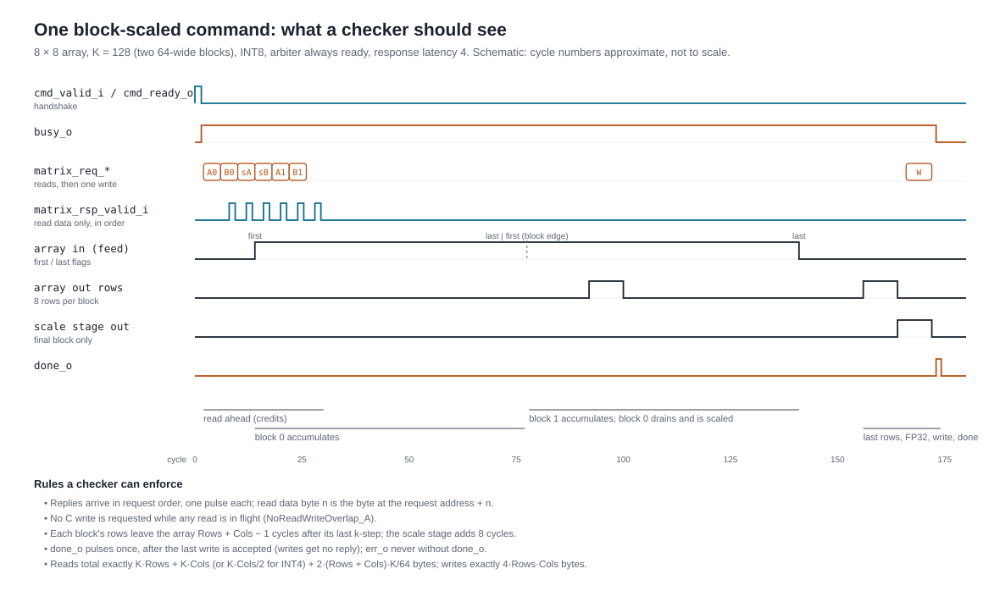
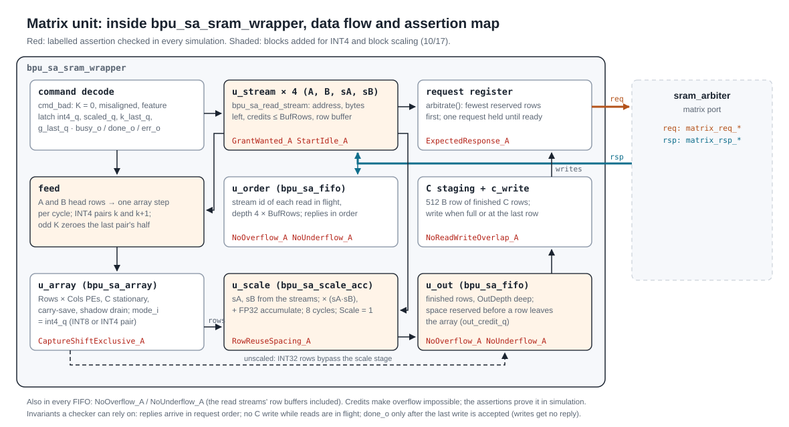
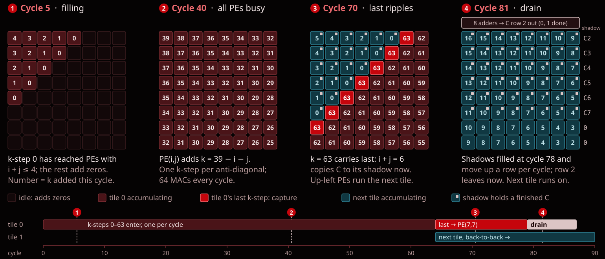

# Matrix Unit I/O Scheme

The Matrix Unit computes one tile of `C = A · B` per command on an output-stationary
systolic array:
- A holds INT8 activations;
- B holds INT8 or packed INT4 weights;
- C is either exact INT32 or, with block scaling, FP32.

The top level is `bpu_sa_sram_wrapper`. It takes one command at a time and works through the
[SRAM arbiter](../memory/sram_arbiter_io_scheme.md)'s matrix port:
1. reads A, B and (if block-scaled) two scale tables;
2. runs the array;
3. writes C back through the same port.

The command interface and the matrix port below are the ones the final Matrix Unit keeps. **Update
this document alongside RTL changes.** The RTL header comments are the detailed reference:
[bpu_sa_sram_wrapper.sv](../../rtl/compute/Matrix_Unit/bpu_sa_sram_wrapper.sv) for the unit and
[bpu_sa_array.sv](../../rtl/compute/Matrix_Unit/bpu_sa_array.sv) for the array. Diagrams are in
[matrix_unit/](matrix_unit/README.md).

## 1. Top-level ports


All ports are in the single `clk_i` domain. Widths are at the default parameters.

| Port | Dir | Width | Meaning |
| --- | --- | --- | --- |
| `clk_i` | in | 1 | Rising-edge clock. |
| `rst_ni` | in | 1 | Active-low reset. It may assert asynchronously and must deassert synchronously to `clk_i`. |
| `cmd_valid_i` | in | 1 | A command is offered. |
| `cmd_ready_o` | out | 1 | Equal to `!busy_o`, and registered, so one command runs at a time. |
| `cmd_k_i` | in | 16 (`KW`) | K, the reduction length: 1 to 2^KW − 1. |
| `cmd_int4_i` | in | 1 | B is packed INT4: two signed 4-bit weights per byte. |
| `cmd_scaled_i` | in | 1 | Block-scaled: FP32 C, using the scale tables at `cmd_sa_addr_i` and `cmd_sb_addr_i`. |
| `cmd_a_addr_i`, `cmd_b_addr_i`, `cmd_c_addr_i` | in | 32 each | Byte addresses of A, B and C. They must be row aligned. |
| `cmd_sa_addr_i`, `cmd_sb_addr_i` | in | 32 each | Byte addresses of the activation and weight scale tables. They are ignored when `cmd_scaled_i` = 0. |
| `busy_o` | out | 1 | High from the cycle after a command is accepted until it completes. |
| `done_o` | out | 1 | One-cycle pulse when the command completes, in the first cycle `busy_o` is low again. |
| `err_o` | out | 1 | One-cycle pulse with `done_o` for an illegal command. It is never high without `done_o`. |
| `matrix_req_valid_o` | out | 1 | A request to the arbiter. |
| `matrix_req_ready_i` | in | 1 | The arbiter accepts the request. |
| `matrix_req_is_write_o` | out | 1 | 1: write, 0: read. |
| `matrix_req_size_bytes_o` | out | 10 | Bytes in the request, 1 to 512. |
| `matrix_req_addr_o` | out | 32 | Row-aligned byte address. |
| `matrix_req_wdata_o` | out | 4096 | Write data: byte n goes to address + n. |
| `matrix_rsp_valid_i` | in | 1 | One-cycle pulse per completed read. |
| `matrix_rsp_rdata_i` | in | 4096 | Read data: byte n is the byte at the request address + n. |

| Parameter | Default | Meaning |
| --- | --- | --- |
| `Rows`, `Cols` | 8, 8 | Shape of the C tile, as powers of two. Rows: 1 to DataW/16. Cols: 1 to DataW/32 (at least 2 with `Int4`). |
| `AccW` | 32 | Accumulator width, 16 to 32. Unscaled results are exact while K < 2^(AccW − 15). |
| `Int4` | 1 | Build the INT4-weight mode. Without it, `cmd_int4_i` = 1 is illegal. |
| `Scale` | 1 | Build the block-scaling stage. Without it, `cmd_scaled_i` = 1 is illegal. |
| `BlockK` | 64 | k-steps per scale block: a power of two, 32 to 1024. |
| `BufRows` | 2 | SRAM rows buffered per read stream. |
| `OutDepth` | 9 | Finished C rows queued for write-back. |
| `WriteAcks` | 0 | 0: writes get no response, as the arbiter specifies. 1: for an arbiter that also acknowledges writes. |
| `AddrW`, `DataW`, `SizeW` | 32, 4096, 10 | The arbiter port widths: `sram_arbiter_pkg` `ADDR_WIDTH`, `DATA_WIDTH`, `SIZE_WIDTH`. |
| `KW` | 16 | Width of `cmd_k_i`. |

## 2. Using the Matrix Unit

### Commands

A command transfers on a rising edge when `cmd_valid_i && cmd_ready_o`. Hold the command fields
stable until then.

**Illegal commands** are accepted, touch no memory, and get `done_o` and `err_o` together one cycle
later. A command is illegal when any of these holds:
- K = 0;
- a base address in use is not row aligned;
- `cmd_int4_i` = 1 in a build without `Int4`;
- `cmd_scaled_i` = 1 in a build without `Scale`, or with K not a multiple of `BlockK`.

**Reset** cancels the command in progress. No `done_o` is sent for it, and C in SRAM may be partly
written. The arbiter must be reset with the unit and must drop responses still in flight (its
proposed reset contract). Reset clears control state only; buffers and accumulators are data storage
and are not cleared.

### Memory layout

All addresses are byte addresses. One SRAM row is `DataW/8` = 512 bytes, and every base address
must be row aligned.

| Operand | Layout | Element address |
| --- | --- | --- |
| A, `Rows × K` INT8 | k-major: column k of A is `Rows` consecutive bytes | `A[i][k]` at `a_addr + k·Rows + i` |
| B, `K × Cols` INT8 | row-major | `B[k][j]` at `b_addr + k·Cols + j` |
| B, `K × Cols` INT4 | row-major nibbles, low nibble first (the repository's W4 format) | `B[k][j]` is nibble `n = k·Cols + j` in byte `b_addr + n/2`; the low nibble when n is even |
| sA, `Rows × G` bf16 | block-major, little-endian | `sA[i][g]` at `sa_addr + 2·(g·Rows + i)` |
| sB, `G × Cols` bf16 | block-major, little-endian | `sB[g][j]` at `sb_addr + 2·(g·Cols + j)` |
| C, `Rows × Cols` | row-major, 4 bytes little-endian each | `C[r][j]` at `c_addr + 4·(r·Cols + j)` |

Here G = K / `BlockK`. When unscaled, C is int32, sign-extended from `AccW`; when block-scaled, it
is IEEE binary32. The unit writes exactly the `4·Rows·Cols` bytes of C and nothing else.

### Arithmetic

**Unscaled:** `C[i][j] = Σ_k A[i][k] · B[k][j]`, exact, wrapping at `AccW` bits.

**Block-scaled:** K splits into G blocks of `BlockK`, and

```text
C[i][j] = Σ over g = 0 .. G−1, in increasing g, of f32(isum[i][j][g]) · (f32(sA[i][g]) · f32(sB[g][j]))
```

- `isum` is the exact integer sum over block g.
- Every product and add is binary32 with round-to-nearest-even, starting from +0.0.
- This is the repository's QMV numerics contract (`compute/docs/numerics.md`, `qmv_ref`) extended
  from matrix × vector to matrix × matrix.

**INT4 weights** run the array two k-steps per cycle. With an odd K, the second half of the last pair
is zeroed.

### The SRAM matrix port

The unit is the requester on the arbiter's matrix port and follows its
[protocol](../memory/sram_arbiter_io_scheme.md):
- **Requests** are ready/valid. `matrix_req_*` depend only on registers. Valid never waits for
  ready, and the request stays unchanged until it is accepted.
- **Reads** ask for one SRAM row at a time (`size_bytes` = 512). The exception is an operand's last
  read, which asks for exactly the bytes that remain.
- **Read responses** can't be stalled, so a read is only issued when its buffer has room for the
  response.
- **Choosing a stream:** the four read streams (A, B, sA, sB) share the port. The stream with the
  fewest rows reserved goes first, in the order A, B, sA, sB on a tie.
- **Writes** carry up to one SRAM row of C. `size_bytes` covers exactly the C bytes in that write.
- **Responses** are one `matrix_rsp_valid_i` pulse per read, in request order. **Writes get no
  response.** `done_o` follows the acceptance of the last write; write completion is reported to
  the scoreboard by the arbiter.
- **Reads and writes never overlap:** writes start only after every read has returned
  (`NoReadWriteOverlap_A`).

**Bytes per command:**
- Reads: `K·Rows` (A), plus `K·Cols` (INT8 B) or `⌈K·Cols/2⌉` (INT4 B), plus `2·(Rows + Cols)·G`
  for the scale tables when block-scaled.
- Writes: `4·Rows·Cols`.

### Timing

L below is the arbiter's round trip, from request to response.
- **First k-step:** enters the array about L + 2 cycles after the command is accepted, once the
  first A and B rows are back.
- **Streaming:** array steps then go one per cycle while the read buffers keep up.
- **C rows:** they leave the array `Rows + Cols − 1` cycles after the last array step, plus 8 more
  cycles when block-scaled. They are written one SRAM row at a time.
- **Block-scaled commands:** blocks stream without stalls while a block's array steps (`BlockK`, or
  `BlockK/2` for INT4) are at least `2·Rows + Cols`.



## 3. Internal data flow



### The array (`bpu_sa_array`)

PE(i, j) owns C[i][j]. C stays in the PE while the tile accumulates:
- A moves right, carrying the tile's `first` and `last` flags;
- B moves down.

Row i of A is delayed i cycles and column j of B j cycles, so `A[i][k]` and `B[k][j]` meet in
PE(i, j). The k-step accepted on cycle t reaches PE(i, j) on cycle `t + 1 + i + j`.


**Inside each PE:** a multiply-add tree, an accumulator and a shadow register.
- **Accumulate:** both registers are carry-save: two vectors whose sum is the value. Each cycle,
  eight partial-product rows plus the accumulator's two vectors reduce to two vectors through 3:2
  adders, so no PE propagates a carry.
- **Capture:** on `last`, the PE copies its sum into the shadow register, and the next tile starts
  accumulating on the following cycle.
- **Drain:** once every PE has captured, the shadows shift up one row per cycle. The top edge adds
  sum + carry, one adder per column, and sends out one row of C.

In INT4 mode, the same eight rows form two 8 × 4 products, `A[i][k]·B[k][j] + A[i][k+1]·B[k+1][j]`.



The array also has its own ready/valid interface:
- **In:** `in_valid_i` / `in_ready_o`, plus one k-step on `in_a_i` / `in_b_i` with `in_first_i` /
  `in_last_i`;
- **Out:** `out_valid_o` / `out_ready_i`, plus one C row on `out_row_o` with `out_row_idx_o` /
  `out_last_o`.

See its header for the exact rules.

### Block scaling (`bpu_sa_scale_acc`)

Each block of `BlockK` k-steps runs as its own array tile. As block g's rows drain:
1. the scale stage converts each integer sum to FP32 (exactly);
2. multiplies it by `sA·sB`;
3. adds it into a per-row FP32 accumulator.

Meanwhile block g + 1 accumulates in the array. Only the final block's rows leave the stage.

## 4. Small example

This is a 2 × 2 build (`Rows = Cols = 2`) running an unscaled INT8 command with K = 3.

```text
A = [ 1  -2   3 ]     B = [  5  6 ]     C = A·B = [ -12  -4 ]
    [ 4   0  -1 ]         [  7  8 ]               [  21  22 ]
                          [ -1  2 ]
```

| Region | Bytes (hex, lowest address first) |
| --- | --- |
| A at `a_addr`, k-major | `01 04  FE 00  03 FF` |
| B at `b_addr`, row-major | `05 06  07 08  FF 02` |
| C at `c_addr`, int32 little-endian | `F4 FF FF FF  FC FF FF FF  15 00 00 00  16 00 00 00` |

The command is `cmd_k_i` = 3, `cmd_int4_i` = 0, `cmd_scaled_i` = 0. On the matrix port this
gives:
1. a 6-byte read of A;
2. a 6-byte read of B;
3. the two read responses;
4. one 16-byte write of C, after which `done_o` pulses.

## 5. Sources and tests

Sources are in [rtl/compute/Matrix_Unit](../../rtl/compute/Matrix_Unit). `bpu_sa_array.f` lists
the compile order.

| File | Contents |
| --- | --- |
| `bpu_sa_sram_wrapper.sv` | The top level: command, read arbitration, feed, drain, C write-back. |
| `bpu_sa_read_stream.sv` | One read stream (A, B or a scale table). |
| `bpu_sa_scale_acc.sv` | The block-scaling stage. |
| `bpu_sa_fifo.sv` | Buffers and queues. |
| `bpu_sa_array.sv`, `bpu_sa_pe.sv`, `bpu_sa_delay.sv` | The systolic array. |
| `rtl/compute/fp/*`, `rtl/compute/common/*` | The FP32 units the scale stage uses. |

Run `make test-matrix-unit` from the repository root. The
[test guide](../../tb/compute/Matrix_Unit/README.md) covers VCS setup, the testbenches, the
`sram_arbiter_matrix_model` that stands in for the arbiter, and the required negative tests. The
[diagram folder](matrix_unit/README.md) lists what each testbench checks and what isn't covered
yet.

## 6. Open items

- **Block-scaling parameters** are proposals awaiting a team decision: block size, bf16 or
  power-of-two scales, how activation scales are grouped, and FP32 C.
- **Arbiter reset contract:** dropping in-flight responses on reset is the arbiter's proposed
  contract and still needs confirmation.
- **Command source:** a sequencer or RISC-V command issuer will drive the command port. Its
  encoding of these fields is defined outside this unit.
