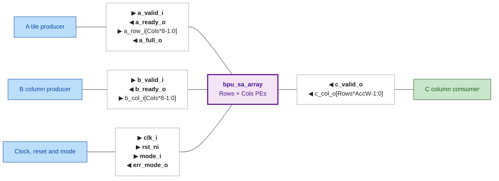
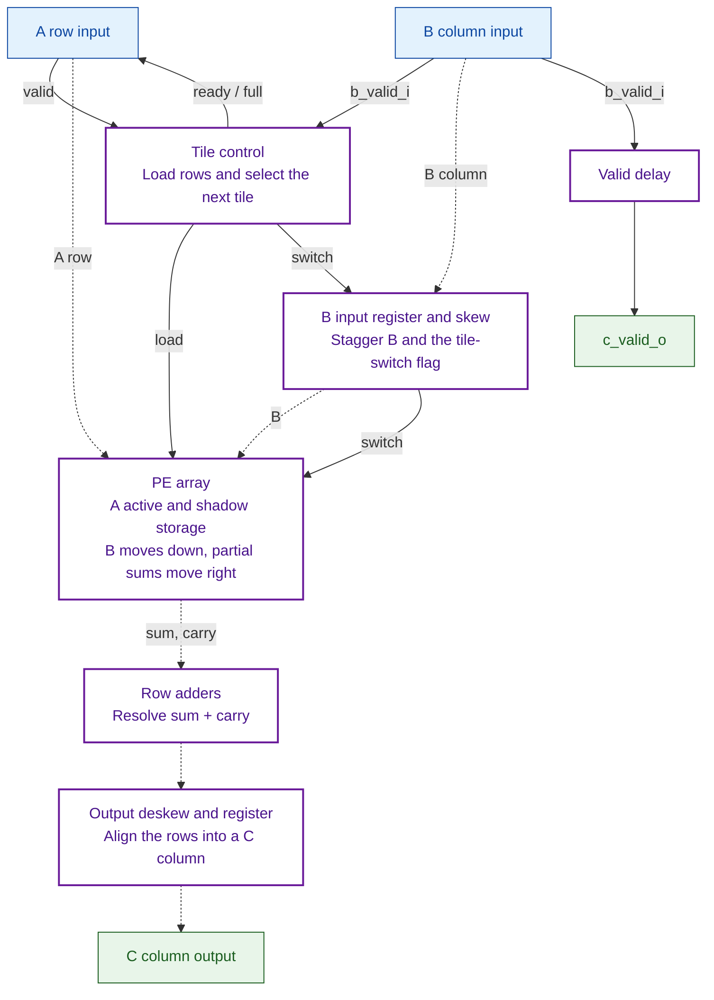
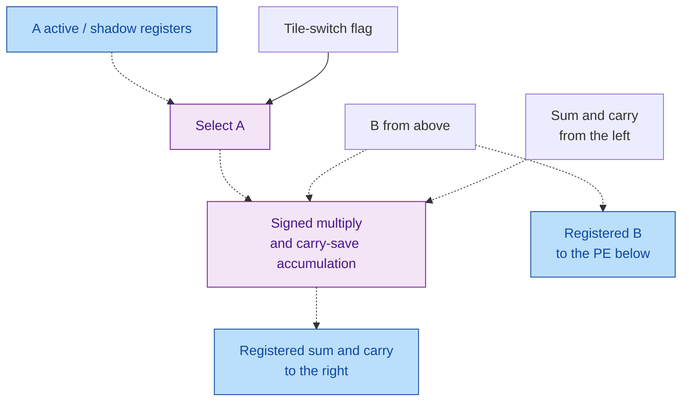

# Matrix Unit I/O Scheme

The Matrix Unit is still under development. This guide describes its current
INT8 systolic-array datapath, `bpu_sa_array`. **Update this document alongside
RTL changes**, especially changes to the ports, tile loading, and timing.

The array holds an A tile and multiplies it by a stream of B columns to produce
C columns. SRAM access and command handling still need surrounding integration;
see the [shared architecture](https://github.com/SiliconBadgers/architecture/blob/main/docs/accelerator-diagram.md)
and [SRAM arbiter I/O scheme](../memory/sram_arbiter_io_scheme.md) for that context.
The implementation is tracked in [issue #19](https://github.com/SiliconBadgers/rtl/issues/19).

## 1. Top-level ports

`▶` marks an input to the array and `◀` an output. Control signals are bold;
data payloads are plain.



### Shape and data layout

A has `Rows` rows and `Cols` columns. Each B column contains `Cols` signed INT8
values and produces `Rows` signed results:

```text
C[i,j] = sum over k of A[i,k] * B[k,j]
```

| Parameter | Default | Meaning |
| --- | --- | --- |
| `Rows` | 8 | Number of A rows and results per C column; at least 1. |
| `Cols` | 8 | Number of terms in each dot product; at least 1. |
| `AccW` | 32 | Bits per result; the current RTL requires at least `16 + $clog2(Cols)`. |

Element 0 occupies the least-significant slice of each payload:

| Payload | Element slice | Value |
| --- | --- | --- |
| `a_row_i` | `[8*k +: 8]` | A element in column `k`. |
| `b_col_i` | `[8*k +: 8]` | B element in row `k`. |
| `c_col_o` | `[AccW*i +: AccW]` | C element in row `i`. |

Interpret each slice as a signed two's-complement value. Each C column is a
fresh set of dot products; the array does not accumulate across B columns or
A tiles. Arithmetic wraps at `AccW` bits, with no saturation. The supported
width bound accommodates the full INT8 dot product.

## 2. Using the array

### Load A, last row first

A row transfers on a rising `clk_i` edge when `a_valid_i && a_ready_o`.
Assert valid when a row is available and hold both valid and data until accepted.
Send `Rows` rows in reverse order: last row first, row 0 last. Rows shift downward
through the array as they load.

The array stores an **active tile** for computation and a **shadow tile** holding
the next A tile. `a_full_o` means a complete shadow tile is waiting. It is
not an idle or operation-complete indication.

Load a complete first tile before sending B. The array accepts B even without
an initialized A tile, but the resulting C values are undefined.

### Stream B and capture C

`b_ready_o` is always high. Every rising edge with `b_valid_i` accepts one B
column. Once the pipeline fills, the array can produce one C column per cycle,
in input order. Gaps in B valid become matching gaps in C valid; the pipeline
keeps advancing.

Capture `c_col_o` every cycle that `c_valid_o` is high. **C has no ready signal.**
If the consumer can stall, provide buffering and leave room for results already
in flight before sending more B columns.

The current RTL defines `LATENCY_CYCLES = Rows + Cols + 1`. For a B column
accepted at rising edge `n`, its C data and valid appear just after edge
`n + Rows + Cols`; a clocked consumer captures them at edge
`n + LATENCY_CYCLES`.

### Switch to the next A tile

The next tile can load while the active tile computes. Once `a_full_o` is high,
**the next valid B column automatically switches to the waiting tile**. Earlier
B columns still in flight finish using the old tile. There is no separate
switch command, so coordinate A loading with the B stream.

A B column accepted on the same edge as the final A row still uses the old tile.
The earliest column that can use the newly completed tile arrives on the next
edge. At startup, wait until `a_full_o` is high before sending the first B column.

A loading pauses while the switch travels through the array. Resume loading
when `a_ready_o` is high. B can keep streaming during this pause.

### Reset and mode

`rst_ni` is active low. It may assert asynchronously; the surrounding design must
release it synchronously to `clk_i`. Keep A and B valid low during reset.

Reset discards partial tiles and in-flight results, clears `a_full_o` and
`c_valid_o`, and restores `a_ready_o`. Data storage is not cleared, so load a
complete fresh A tile before restarting B.

Use `mode_i = 0` for INT8. INT4 is reserved: `mode_i = 1` raises `err_mode_o`,
but the array continues computing INT8 and producing valid outputs.

## 3. Internal data flow

A stays in the processing elements (PEs), B moves down, and partial sums move
right. Input delays stagger the B elements so each product meets the matching
partial sum. Output delays align the rows into one C column.

Solid arrows below carry control; dotted arrows carry data.



### Inside a PE

Each PE holds one A element in active and shadow registers. Loading shifts A
values through shadow storage. When the tile-switch flag reaches a PE, it uses
the shadow value for that B element and makes it the active value.



Each PE adds its product to the incoming partial sum and registers the result
for the next PE. The partial sum travels as two vectors, `sum` and `carry`,
whose value is `sum + carry`. Keeping them separate avoids a carry-propagate
adder in every PE; one adder at each row's right edge resolves the final result.

`bpu_sa_delay` supplies the input skew, output alignment, and valid delay.

## 4. Small example

For a 2×2 array:

```text
A = [ 1  -2 ]     B column = [ 5 ]     C column = [ -7 ]
    [ 3   4 ]                [ 6 ]                [ 39 ]
```

Load `[3, 4]` first, then `[1, -2]`. Once the tile is full, send `[5, 6]` as a
B column. The result is `[1*5 - 2*6, 3*5 + 4*6] = [-7, 39]`. Row 0's result
occupies the low `AccW` bits of `c_col_o`.

## 5. Sources and tests

- [bpu_sa_array.sv](../../rtl/compute/Matrix_Unit/bpu_sa_array.sv): interface, tile control, and array wiring.
- [bpu_sa_pe.sv](../../rtl/compute/Matrix_Unit/bpu_sa_pe.sv): A storage and multiply-accumulate logic.
- [bpu_sa_delay.sv](../../rtl/compute/Matrix_Unit/bpu_sa_delay.sv): delay stages.

Run `make test-matrix-unit` from the repository root. The
[test guide](../../tb/compute/Matrix_Unit/README.md) covers the required VCS setup,
test cases, and reproduction commands. See the
[existing verification report](../../tb/compute/Matrix_Unit/reports/2026-10-12-pr14.md)
for recorded results and their limitations.
