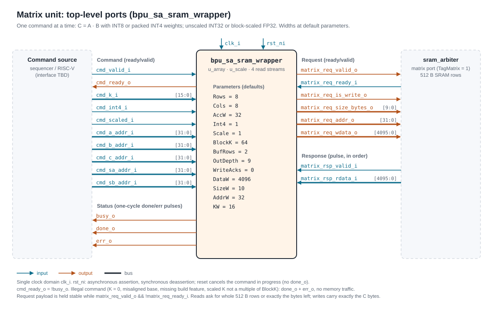
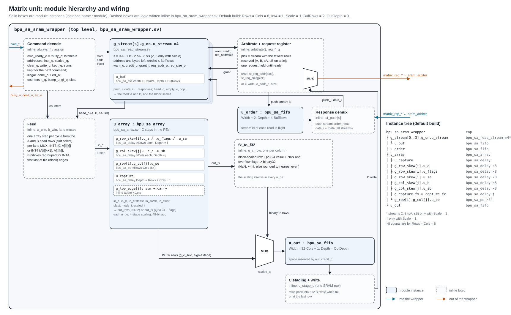
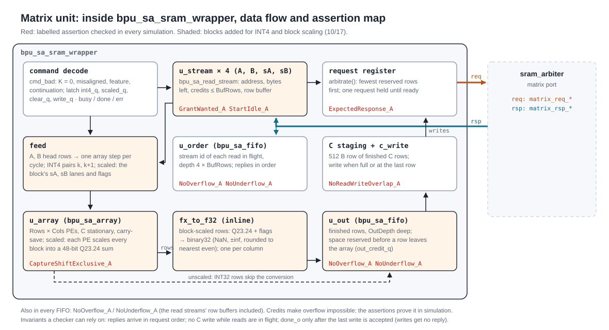
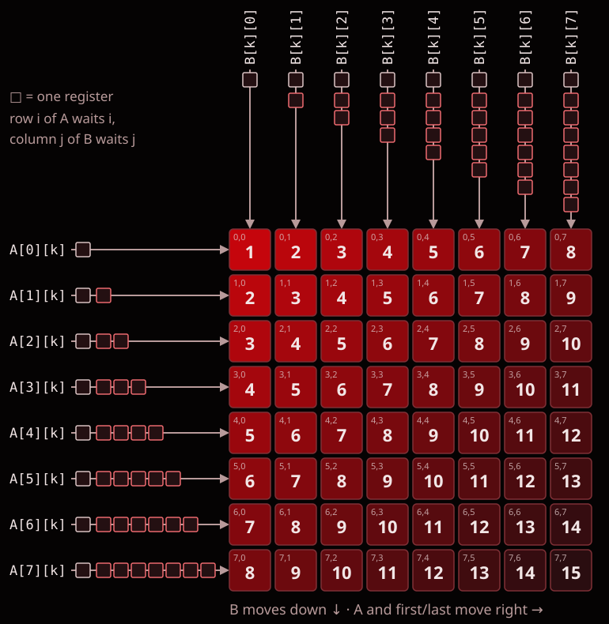

# Matrix Unit I/O Scheme

The Matrix Unit computes one tile of `C = A · B` per command on an output-stationary
systolic array:
- A holds INT8 activations;
- B holds INT8 or packed INT4 weights;
- C is either exact INT32 or, with block scaling, binary32 (FP32) converted from a fixed-point
  sum kept in each PE.

The top level is `bpu_sa_sram_wrapper`. It takes one command at a time and works through the
[SRAM arbiter](../memory/sram_arbiter_io_scheme.md)'s matrix port:
1. reads A, B and (if block-scaled) two scale tables;
2. runs the array;
3. writes C back through the same port.

The command interface and the matrix port below are the ones the final Matrix Unit keeps. **Update
this document alongside RTL changes.** The RTL header comments are the detailed reference:
[bpu_sa_sram_wrapper.sv](../../rtl/compute/Matrix_Unit/bpu_sa_sram_wrapper.sv) for the unit and
[bpu_sa_array.sv](../../rtl/compute/Matrix_Unit/bpu_sa_array.sv) for the array. Diagrams are in
[matrix_unit/](matrix_unit/README.md).

## 1. Top-level ports



All ports are in the single `clk_i` domain. Widths are at the default parameters.

| Port | Dir | Width | Meaning |
| --- | --- | --- | --- |
| `clk_i` | in | 1 | Rising-edge clock. |
| `rst_ni` | in | 1 | Active-low reset. It may assert asynchronously and must deassert synchronously to `clk_i`. |
| `cmd_valid_i` | in | 1 | A command is offered. |
| `cmd_ready_o` | out | 1 | Equal to `!busy_o`, and registered, so one command runs at a time. |
| `cmd_k_i` | in | 16 (`KW`) | K, the reduction length: 1 to 2^KW − 1. |
| `cmd_int4_i` | in | 1 | B is packed INT4: two signed 4-bit weights per byte. |
| `cmd_scaled_i` | in | 1 | Block-scaled: binary32 C, using the scale tables at `cmd_sa_addr_i` and `cmd_sb_addr_i`. |
| `cmd_clear_acc_i` | in | 1 | 1: start this command's sums from zero. 0: add them to the sums the previous command kept. |
| `cmd_write_output_i` | in | 1 | 1: write the finished C tile to `cmd_c_addr_i`. 0: keep the sums in the unit for the next command; nothing is written. |
| `cmd_a_addr_i`, `cmd_b_addr_i`, `cmd_c_addr_i` | in | 32 each | Byte addresses of A, B and C. They must be row aligned; C is ignored when `cmd_write_output_i` = 0. |
| `cmd_sa_addr_i`, `cmd_sb_addr_i` | in | 32 each | Byte addresses of the activation and weight scale tables. They are ignored when `cmd_scaled_i` = 0. |
| `busy_o` | out | 1 | High from the cycle after a command is accepted until it completes. |
| `done_o` | out | 1 | One-cycle pulse when the command completes, in the first cycle `busy_o` is low again. |
| `err_o` | out | 1 | One-cycle pulse with `done_o` for an illegal command. It is never high without `done_o`. |
| `matrix_req_valid_o` | out | 1 | A request to the arbiter. |
| `matrix_req_ready_i` | in | 1 | The arbiter accepts the request. |
| `matrix_req_is_write_o` | out | 1 | 1: write, 0: read. |
| `matrix_req_size_bytes_o` | out | 10 | Bytes in the request, 1 to 512. |
| `matrix_req_addr_o` | out | 32 | Row-aligned byte address. |
| `matrix_req_wdata_o` | out | 4096 | Write data: byte n goes to address + n. |
| `matrix_rsp_valid_i` | in | 1 | One-cycle pulse per completed read. |
| `matrix_rsp_rdata_i` | in | 4096 | Read data: byte n is the byte at the request address + n. |

| Parameter | Default | Meaning |
| --- | --- | --- |
| `Rows`, `Cols` | 8, 8 | Shape of the C tile, as powers of two. Rows: 1 to DataW/16. Cols: 1 to DataW/32 (at least 2 with `Int4`). |
| `AccW` | 32 | Integer accumulator width, 16 to 32 (at least 25 with `Scale`). Unscaled results are exact while K < 2^(AccW − 15). |
| `Int4` | 1 | Build the INT4-weight mode. Without it, `cmd_int4_i` = 1 is illegal. |
| `Scale` | 1 | Build block scaling in every PE. Without it, `cmd_scaled_i` = 1 is illegal. |
| `BlockK` | 16 | k-steps per scale block: a power of two, 16 to 1024. |
| `BufRows` | 2 | SRAM rows buffered per read stream. |
| `OutDepth` | 9 | Finished C rows queued for write-back. |
| `WriteAcks` | 0 | 0: writes get no response, as the arbiter specifies. 1: for an arbiter that also acknowledges writes. |
| `AddrW`, `DataW`, `SizeW` | 32, 4096, 10 | The arbiter port widths: `sram_arbiter_pkg` `ADDR_WIDTH`, `DATA_WIDTH`, `SIZE_WIDTH`. |
| `KW` | 16 | Width of `cmd_k_i`. |

## 2. Using the Matrix Unit

### Commands

A command transfers on a rising edge when `cmd_valid_i && cmd_ready_o`. Hold the command fields
stable until then.

**Illegal commands** are accepted, touch no memory, and get `done_o` and `err_o` together one cycle
later. A command is illegal when any of these holds:
- K = 0;
- a base address in use is not row aligned;
- `cmd_int4_i` = 1 in a build without `Int4`;
- `cmd_scaled_i` = 1 in a build without `Scale`, or with K not a multiple of `BlockK`;
- `cmd_clear_acc_i` = 0 when no sums are kept, or when the kept sums are of the other kind
  (unscaled vs block-scaled).

An illegal command leaves any kept sums as they were.

**Reset** cancels the command in progress and discards kept sums. No `done_o` is sent for the
cancelled command, and C in SRAM may be partly written. The arbiter must be reset with the unit and must drop responses still in flight (its
proposed reset contract). Reset clears control state only; buffers and accumulators are data storage
and are not cleared.

### Chaining commands along K

`cmd_clear_acc_i` and `cmd_write_output_i` split one long dot product across several commands. They
are `clear_acc` and `write_output` in the draft command format (`docs/command-format.md` on
`codex/command-format-spec`), which records this as a compute-team decision: the unit has "an input
controlling whether to write the output or to keep it in the accumulators".

| Use | `cmd_clear_acc_i` | `cmd_write_output_i` |
| --- | --- | --- |
| Standalone command | 1 | 1 |
| First K tile | 1 | 0 |
| Middle K tile | 0 | 0 |
| Last K tile | 0 | 1 |

- **Unscaled:** the sums stay in the PE accumulators, so C never leaves the array between
  commands. The result is the same as one command over the whole K, including the wrap at `AccW`
  bits.
- **Block-scaled:** the sums stay in the PEs' fixed-point accumulators. Blocks continue in
  increasing order across the commands, so the result is the same as one command over all the
  blocks.
- **Mixing kinds:** a chain is all unscaled or all block-scaled. INT8 and INT4 commands may mix.
- **Completion:** a command that keeps its sums has `done_o` once its last contribution has
  settled: `Rows + Cols` cycles after its last array step, plus 4 when block-scaled. The next
  command can then start at once, in either mode.

### Memory layout

All addresses are byte addresses. One SRAM row is `DataW/8` = 512 bytes, and every base address
must be row aligned.

| Operand | Layout | Element address |
| --- | --- | --- |
| A, `Rows × K` INT8 | k-major: column k of A is `Rows` consecutive bytes | `A[i][k]` at `a_addr + k·Rows + i` |
| B, `K × Cols` INT8 | row-major | `B[k][j]` at `b_addr + k·Cols + j` |
| B, `K × Cols` INT4 | row-major nibbles, low nibble first (the W4 format) | `B[k][j]` is nibble `n = k·Cols + j` in byte `b_addr + n/2`; the low nibble when n is even |
| sA, `Rows × G` bf16 | block-major, little-endian | `sA[i][g]` at `sa_addr + 2·(g·Rows + i)` |
| sB, `G × Cols` bf16 | block-major, little-endian | `sB[g][j]` at `sb_addr + 2·(g·Cols + j)` |
| C, `Rows × Cols` | row-major, 4 bytes little-endian each | `C[r][j]` at `c_addr + 4·(r·Cols + j)` |

Here G = K / `BlockK`. When unscaled, C is int32, sign-extended from `AccW`; when block-scaled, it
is IEEE binary32 (see Arithmetic). The unit writes exactly the `4·Rows·Cols` bytes of C and nothing
else.

### Arithmetic

**Unscaled:** `C[i][j] = Σ_k A[i][k] · B[k][j]`, exact, wrapping at `AccW` bits.

**Block-scaled:** K splits into G = K / `BlockK` blocks (16 k-steps by default). For each element
and each block g, in increasing g:

1. `isum[i][j][g]` = Σ over the block's k of `A[i][k] · B[k][j]`, exact;
2. the contribution `round(isum · sA[i][g] · sB[g][j] · 2^24)`. The scale product and
   `isum · ma · mb` are exact; the only rounding is this one, to nearest with ties to even;
3. `acc[i][j]` += the contribution. `acc` is a 48-bit signed fixed-point value with 24
   fractional bits (Q23.24), starting from 0 when `cmd_clear_acc_i` = 1.

`C[i][j]` is `acc / 2^24` as IEEE binary32, rounded to nearest even. Blocks with different scales
are never added as raw integers.

| Case | Result |
| --- | --- |
| Zero or subnormal scale (exponent 0) | Counts as zero |
| Inf or NaN scale (exponent 255) | `C[i][j]` is NaN (`0x7FC00000`) |
| A contribution, or a sum, outside the 48-bit range | `acc` saturates at that limit; `C[i][j]` is ±infinity (the sign of `acc`) |

**Accumulator widths**, derived from the operand ranges (INT8: −128 to 127; INT4: −8 to 7). The
largest values come from two negative limits multiplied together:

| Quantity | Range | Signed bits |
| --- | --- | --- |
| INT8 × INT8 product | −16,256 to 16,384 | 16 |
| INT8 × INT4 product | −1,016 to 1,024 | 12 |
| Block of 16, INT8 × INT4 | −16,256 to 16,384 | 16: INT16 is exactly enough |
| Block of 16, INT8 × INT8 | −260,096 to 262,144 (2^18) | 20: INT16 would overflow |
| Block of `BlockK`, INT8 × INT8 | at most `BlockK · 2^14` | `16 + log2(BlockK)` |
| Unscaled sum over K | at most `K · 2^14` | exact while K < 2^(AccW − 15) |
| Block-scaled sum (Q23.24) | below 2^23 ≈ 8.4 million, in steps of 2^−24 ≈ 6·10^−8 | 48 |

**What is decided and what is assumed.** No written specification fixes the block-scaled
numerics yet, so this implementation marks its choices:

| Choice | Status |
| --- | --- |
| INT8 activations; INT4 or INT8 weights with block scales | Compute-team decision (architecture `decisions/compute-team-decisions.md`) |
| Block contributions scaled before they are combined | Draft command format |
| `BlockK` = 16 | From the 10/17 compute meeting; not yet in a written spec |
| bf16 scales | Assumption (discussed 10/17) |
| Q23.24 in 48 bits, saturating | Assumption (the meeting discussed 24 fractional bits and 32/48-bit accumulators) |
| binary32 output | Assumption (FP16 was discussed; INT8 requantization needs a spec) |
| Exponent-0 scales as zero; inf/NaN scales give NaN | Assumption |
| K a multiple of `BlockK` | Assumption (the command format is silent on partial blocks) |

**INT4 weights** run the array two k-steps per cycle. With an odd K, the second half of the last pair
is zeroed.

### The SRAM matrix port

The unit is the requester on the arbiter's matrix port and follows its
[protocol](../memory/sram_arbiter_io_scheme.md):
- **Requests** are ready/valid. `matrix_req_*` depend only on registers. Valid never waits for
  ready, and the request stays unchanged until it is accepted.
- **Reads** ask for one SRAM row at a time (`size_bytes` = 512). The exception is an operand's last
  read, which asks for exactly the bytes that remain.
- **Read responses** can't be stalled, so a read is only issued when its buffer has room for the
  response.
- **Choosing a stream:** the four read streams (A, B, sA, sB) share the port. The stream with the
  fewest rows reserved goes first, in the order A, B, sA, sB on a tie.
- **Writes** carry up to one SRAM row of C. `size_bytes` covers exactly the C bytes in that write.
- **Responses** are one `matrix_rsp_valid_i` pulse per read, in request order. **Writes get no
  response.** `done_o` follows the acceptance of the last write; write completion is reported to
  the scoreboard by the arbiter.
- **Reads and writes never overlap:** writes start only after every read has returned
  (`NoReadWriteOverlap_A`).

**Bytes per command:**
- Reads: `K·Rows` (A), plus `K·Cols` (INT8 B) or `⌈K·Cols/2⌉` (INT4 B), plus `2·(Rows + Cols)·G`
  for the scale tables when block-scaled.
- Writes: `4·Rows·Cols` when `cmd_write_output_i` = 1, otherwise none.

### Timing

L below is the arbiter's round trip, from request to response.
- **First k-step:** enters the array about L + 2 cycles after the command is accepted, once the
  first A and B rows are back.
- **Streaming:** array steps then go one per cycle while the read buffers keep up.
- **C rows:** they leave the array `Rows + Cols − 1` cycles after the last array step, plus 4
  when block-scaled. They reach the write-back queue one cycle later, after the wrapper's
  conversion register, and are written one SRAM row at a time.
- **Block-scaled commands:** block ends never stall the array, at any `BlockK`: each PE scales a
  finished block while the next one accumulates.


## 3. Internal data flow

### Module hierarchy

The unit is six modules and one package (`bpu_sa_pkg`, the block-scaled numerics constants) in
`rtl/compute/Matrix_Unit`:
- **`bpu_sa_sram_wrapper`**, the top level, instantiates:
  - four `bpu_sa_read_stream`s, each holding a `bpu_sa_fifo` row buffer;
  - the order FIFO and the output queue (both `bpu_sa_fifo`);
  - `bpu_sa_array`.
- **`bpu_sa_array`** instantiates `Rows × Cols` `bpu_sa_pe`s and the `bpu_sa_delay` input delays.

Command decode, arbitration, the request register, the response demux, the feed, the conversion
of block-scaled results to binary32, and C staging are written inline in the wrapper.



[matrix_unit_modules.svg](matrix_unit/svg/matrix_unit_modules.svg) lists every module's parameters and ports.

### Blocks and assertions



### The array (`bpu_sa_array`)

PE(i, j) owns C[i][j]. C stays in the PE while the tile accumulates:
- A moves right, carrying the tile's `first` and `last` flags;
- B moves down.

Row i of A is delayed i cycles and column j of B j cycles, so `A[i][k]` and `B[k][j]` meet in
PE(i, j). The k-step accepted on cycle t reaches PE(i, j) on cycle `t + 1 + i + j`.



**Inside each PE:** a multiply-add tree, an accumulator and a shadow register.
- **Accumulate:** both registers are carry-save: two vectors whose sum is the value. Each cycle,
  eight partial-product rows plus the accumulator's two vectors reduce to two vectors through 3:2
  adders, so no PE propagates a carry.
- **Capture:** on `last`, the PE copies its sum into the shadow register, and the next tile starts
  accumulating on the following cycle.
- **Drain:** once every PE has captured, the shadows shift up one row per cycle. The top edge adds
  sum + carry, one adder per column, and sends out one row of C.

In INT4 mode, the same eight rows form two 8 × 4 products, `A[i][k]·B[k][j] + A[i][k+1]·B[k+1][j]`.


The array also has its own ready/valid interface:
- **In:** `in_valid_i` / `in_ready_o`, plus one k-step on `in_a_i` / `in_b_i` with `in_first_i` /
  `in_last_i`;
- **Out:** `out_valid_o` / `out_ready_i`, plus one C row on `out_row_o` with `out_row_idx_o` /
  `out_last_o`.

See its header for the exact rules.

### Block scaling inside the PEs

In a block-scaled command, `first` and `last` mark every block, and the block's scales travel
through the array with the data: `sA[i][g]` moves right along row i with A, and `sB[g][j]` moves
down column j with B. So each scale reaches PE(i, j) on the cycle that PE finishes the block. At
each block end the PE:
1. resolves the block sum, multiplies the two bf16 mantissas and adds the exponents;
2. multiplies the block sum by that product (exact), and works out the shift into Q23.24 from
   the exponents;
3. shifts the product into Q23.24, rounding to nearest even with a guard and a sticky bit;
4. adds it into its 48-bit accumulator, saturating.

These are four pipeline stages, so the next block accumulates meanwhile. Two more flags ride with
`last`:
- `sfirst` restarts the 48-bit sum (the command's first block, with `cmd_clear_acc_i`);
- `slast` copies the result into the shadow register for the drain (the last block, with
  `cmd_write_output_i`).

The whole command is one tile and drains once. The wrapper converts each drained value to
binary32 in two cycles:
1. **Registered:** the magnitude and the position of its leading 1, found with a log-depth prefix
   OR.
2. **On the way into the write-back queue:** normalize, round and pack.

**Why inside the PEs.** The alternative is to drain every block's integer sums to a shared
scaling stage at the array edge. Draining a tile takes about `2·Rows + Cols` cycles (about 24 on
8 × 8), but a 16-element block takes only 16 cycles in INT8, or 8 in INT4. The array would stall
on every block, reaching about two-thirds of its peak in INT8 and one-third in INT4. Scaling in
place keeps C stationary across all the blocks and costs no throughput. Its cost is area: each PE
gets the scale lanes, the scaling pipeline and a 48-bit accumulator. It also removes the earlier
FP32 edge stage.

## 4. Small example

This is a 2 × 2 build (`Rows = Cols = 2`) running an unscaled INT8 command with K = 3.

```text
A = [ 1  -2   3 ]     B = [  5  6 ]     C = A·B = [ -12  -4 ]
    [ 4   0  -1 ]         [  7  8 ]               [  21  22 ]
                          [ -1  2 ]
```

| Region | Bytes (hex, lowest address first) |
| --- | --- |
| A at `a_addr`, k-major | `01 04  FE 00  03 FF` |
| B at `b_addr`, row-major | `05 06  07 08  FF 02` |
| C at `c_addr`, int32 little-endian | `F4 FF FF FF  FC FF FF FF  15 00 00 00  16 00 00 00` |

The command is `cmd_k_i` = 3, `cmd_int4_i` = 0, `cmd_scaled_i` = 0, with `cmd_clear_acc_i` =
`cmd_write_output_i` = 1. On the matrix port this gives:
1. a 6-byte read of A;
2. a 6-byte read of B;
3. the two read responses;
4. one 16-byte write of C, after which `done_o` pulses.

## 5. Sources and tests

Sources are in [rtl/compute/Matrix_Unit](../../rtl/compute/Matrix_Unit). `bpu_sa_array.f` lists
the compile order.

| File | Contents |
| --- | --- |
| `bpu_sa_sram_wrapper.sv` | The top level: command, read arbitration, feed, drain, C write-back. |
| `bpu_sa_read_stream.sv` | One read stream (A, B or a scale table). |
| `bpu_sa_fifo.sv` | Buffers and queues. |
| `bpu_sa_array.sv`, `bpu_sa_pe.sv`, `bpu_sa_delay.sv` | The systolic array, with block scaling in every PE. |
| `bpu_sa_pkg.sv` | The block-scaled numerics constants. |

Run `make test-matrix-unit` from the repository root. The
[test guide](../../tb/compute/Matrix_Unit/README.md) covers VCS setup, the testbenches, the
`sram_arbiter_matrix_model` that stands in for the arbiter, and the required negative tests. The
[diagram folder](matrix_unit/README.md) lists what each testbench checks and what isn't covered
yet.

## 6. Open items

- **Weight format.** The target model's tensors are GGUF K-quants (`architecture/docs/matrix-cases.csv`):
  - Q4_K and Q5_K: 8 sub-blocks of 32 per 256-weight super-block, unsigned codes, integer
    sub-block scales and mins, fp16 super-block scales;
  - Q6_K: 16 sub-blocks of 16, signed 6-bit codes, int8 scales;
  - Q8_0: blocks of 32.

  This unit's block-scaled path implements symmetric INT8/INT4 codes with one bf16 scale per
  block on each operand. Running the model therefore needs either offline requantization or a
  format change in the hardware. Integer sub-block scales with floating point only once per
  super-block would also be cheaper per PE. This is the main decision before the block-scaled
  path is final.

- **Block-scaled numerics:** the assumptions in the table under Arithmetic need team sign-off:
  bf16 scales, Q23.24 in 48 bits, binary32 output, and partial blocks. Two related questions are
  also open: how activation scales are grouped (here one per row and block), and whether
  per-tensor scales are folded into `sB`.
- **Requantization to INT8**, which the compute-team decisions ask for, needs a specification of
  the scale, rounding and saturation.
- **Arbiter reset contract:** dropping in-flight responses on reset is the arbiter's proposed
  contract and still needs confirmation.
- **Command source:** a sequencer or RISC-V command issuer will drive the command port. Its
  encoding of these fields is defined outside this unit.
