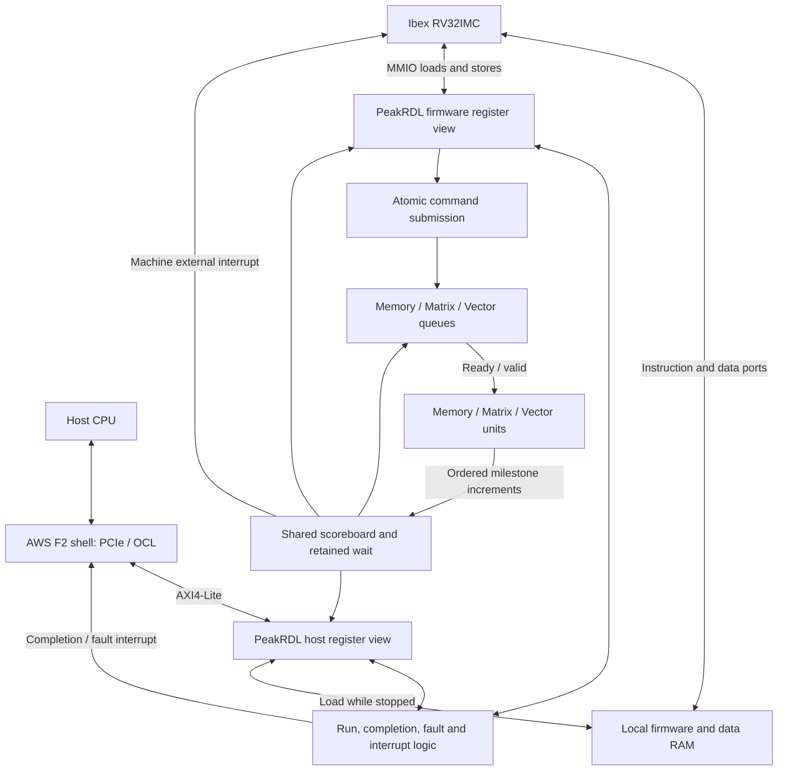

# Top-level control unit specification

The top-level control unit (TLC) runs RISC-V firmware that submits commands to
the Memory, Matrix, and Vector queues. The queues enforce cross-unit
dependencies, and the units publish progress through three milestone counters.
The host loads firmware and job data, starts execution, and receives completion
or fault status over MMIO.

This document proposes the controller integration and register contract. It
follows the RISC-V and queue organization discussed in the
[October 17 compute meeting](https://app.notion.com/p/3fd38826be1b81a2a0cbd0eb0fce8414)
and the MMIO/OCL path in the
[October 19 controller meeting](https://app.notion.com/p/3ff38826be1b8154820fd202d16a28c7).
The [queue specification](command-queues.md) defines ordering and dependency
comparison. The [shared architecture][architecture] supplies system context.
Host-to-HBM DMA is a separate integration task.

## Organization and IP



| Function | Selected implementation | Integration |
| --- | --- | --- |
| Processor | [lowRISC Ibex][ibex], RV32IMC, machine-mode firmware | Use the SoC dependency pin and existing wrapper. Select `RV32MFast`, `RV32BNone`, `ICache=0`, `PMPEnable=0`, `SecureIbex=0`, and `WritebackStage=0`. The current flip-flop register file provides the initial implementation. |
| CSRs | SystemRDL, [PeakRDL-regblock][peakrdl], and [PeakRDL-CHeader][cheader] | Generate register storage, decode, hardware-interface types, and software definitions from one register description. |
| Local memory | True dual-port synchronous RAM; [AMD `XPM_MEMORY_TDPRAM`][xpm-ram] for F2 | One instruction port and one data port. Host loading shares the data port while the processor is stopped. |
| Local interconnect | Native address decoder and response routing | Connect Ibex instruction/data request interfaces to RAM and the firmware CSR view. Each request retains its response destination through completion. |
| Queues and scoreboard | Project `command_queues`, `command_queue`, and `shared_scoreboard` | One FIFO and one progress counter per unit, with the dependency mapping below. |
| Host transport | [AWS F2 shell OCL][aws-shell], 32-bit AXI4-Lite | The shell supplies the PCIe endpoint. TLC supplies the application register and RAM windows. |
| Host interrupt adapter | Project pending/delivery state around the shell user-interrupt interface | Convert controller events to shell request/acknowledgment transactions. |
| Timing and diagnostics | Ibex cycle counters, firmware trap handler, and host status/result registers | Firmware measures elapsed cycles with `mcycle`/`mcycleh` and reports software errors through the job result. |

The SoC repository owns the CPU wrapper and platform composition. Control RTL
owns command submission, queue coordination, and completion. The selected IP
revisions and generator versions belong in the implementation dependency lock.
The existing SoC Ibex pin is
`4dd3932a36b5af5ac002bddbe16a1b4ead1a6fd8`.

The host compiler supplies tiled commands, buffer lifetimes, and dependency
targets. TLC firmware traverses that schedule, submits records, handles local
control flow, and reports the job result. The Vector unit's processor interprets
`VECTOR_RUN` operation IDs and issues its local SIMD instructions.

## Processor and local memory

The processor enters at local byte address `0x00000080`. Firmware initializes
its stack and mutable data, installs its trap vector, and enables interrupts
after their handlers are ready. Instruction fetches and data accesses use the
Ibex request/grant/response protocol. Every accepted read or write receives one
response; MMIO writes complete at their defined side-effect boundary.

Local memory is little-endian and holds code, stack, job parameters, and command
data. `RamWords=4096` supplies 16 KiB initially. The instruction and data ports
each support a registered read; data writes have four byte enables. Reset
clears response validity and preserves stored bytes. Firmware keeps executable
words stable during execution and initializes any padding reachable by prefetch.

| Address space | Byte range | Access |
| --- | --- | --- |
| CPU local RAM | `0x00000000` through `4*RamWords-1` | Instruction fetches, data reads, and byte-enabled data writes. |
| CPU CSRs | `0x40000000` through `0x40000fff` | Firmware register view. |
| Host CSRs | `0x00000000` through `0x00000fff` | Host register view, relative to the assigned OCL aperture. |
| Host RAM | `0x00010000` through `0x00010000+4*RamWords-1` | Word-aligned reads and byte-enabled writes before `START`. |

The host owns local RAM until `START` is accepted. The processor then owns the
RAM for the execution epoch. A coordinated reset returns ownership to the host.
`JOB_ARG` is a software-defined value, conventionally a local-memory pointer.
Tensor addresses inside commands use their unit's address space and width.

## Host interface

Use OCL on the F2 Application PF BAR0. The shell maps a 64 MiB BAR to this
32-bit AXI4-Lite interface; the platform decoder assigns TLC its aperture and
passes local byte offsets to the controller. The controller implements the
register and local-RAM ranges above.

The AXI front end captures write addresses and write data independently and
retains read and write responses until the host accepts them. A successful write
response follows the actual register update or RAM write. The host path remains
serviceable while firmware waits for queue space or job completion.

The host starts a job as follows:

1. Check the register ABI and the firmware's build configuration.
2. Load code, initialized data, and job parameters into local RAM.
3. Write `JOB_ARG` and `IRQ_ENABLE`.
4. Complete the loading writes, apply the platform MMIO ordering operation,
   and read back a controller register before writing `CONTROL.START`.
5. Observe terminal status by polling or interrupt, read `RESULT`, then clear
   the corresponding `IRQ_PENDING` bits.

`START` is accepted once per reset epoch. It sets `RUN` and releases the core
through its reset synchronizer. Completion retains `DONE` and `RESULT` until
the next coordinated reset. The processor can park after publishing completion.

### Interrupt delivery

`host_irq_o = |(IRQ_PENDING & IRQ_ENABLE)` is the controller's level request.
The F2 adapter uses one shell user-interrupt vector, initially vector zero.
It emits one request pulse for a newly enabled pending source and retains
delivery state until the shell acknowledgment pulse. Software clearing
`IRQ_PENDING` acknowledges the underlying event. A shell acknowledgment records
interrupt delivery and leaves software-visible pending state intact.

The adapter tracks delivered sources separately from pending sources. A source
that remains pending is delivered once; clearing and setting it again creates
a new event. A second source becoming pending during an outstanding delivery
is retained for a subsequent request. Enabling an already-pending source also
makes it eligible for delivery.

## Generated register implementation

One SystemRDL source defines the host and firmware views, including offsets,
field widths, reset values, access direction, and hardware update precedence.
Use `regwidth=32` and `accesswidth=32`. Generate C offsets and masks from the
same elaborated configuration used for RTL. Firmware uses generated volatile
32-bit access helpers so each CSR operation uses one aligned word access.

Keep separate host and firmware front ends so a firmware transaction can wait
for a queue while host reads continue. The existing native front ends can use
PeakRDL's [`passthrough` CPUIF][passthrough]; the host AXI adapter converts OCL
transactions to that protocol. Each adapter observes request stalls, captures
the corresponding acknowledgment, and produces one native response. Register
latency follows that handshake.

Shared run, completion, fault, progress, and result state has one owner. The two
generated views expose that state through their hardware interfaces. Storage
for payload staging, dependency staging, masks, and interrupt configuration is
generated. The controller supplies transactional logic for command acceptance,
wait snapshots, completion, ownership checks, and reset.

`START`, `COMMIT`, `WAIT_ARM`, `WAIT_CLEAR`, and `FINISH` use explicit access
events. PeakRDL [external registers][external-registers] provide request and
acknowledgment hooks for actions with controller-defined completion. The wrapper
holds a blocked `COMMIT` or `FINISH` upstream of the generated view. When its
condition passes, one accepted access produces one enqueue or completion event.
The staged record remains stable throughout a blocked commit. Ordinary register
writes and reads retain the access policies in the tables below.

Enable generated errors for unmapped addresses and invalid read/write direction.
The wrapper validates access ownership, alignment, write strobes, and reserved
values before allowing an update. Hardware event set wins over a simultaneous
software interrupt clear. Generator versions, SystemRDL inputs, and elaboration
parameters determine the generated outputs; regeneration is a build check.
Payload and counter widths are elaboration parameters. Each compilation uses
the generated RTL and headers for its selected configuration, and the wrapper
checks that its parameters match the generated configuration package.

## Register map

Offsets are hexadecimal byte offsets within each CSR window. `R` permits both
host and firmware reads. `H` and `F` identify the write owner. Registers use
aligned 32-bit accesses and full-word write strobes. Reset values are zero
except `ABI_VERSION=1` and status derived from empty queues.

| Offset | Register | Access | Meaning |
| --- | --- | --- | --- |
| `000` | `ABI_VERSION` | R | Register contract version, `1`. |
| `004` | `CONTROL` | R/H | Read bit 0 `RUN`; write `1` to start. |
| `008` | `STATUS` | R | Bit 0 `RUN`, bit 1 `DONE`, bit 2 `FAULT`. |
| `00c` | `JOB_ARG` | R/H | Host writes before start; firmware reads its job argument. |
| `010` | `RESULT` | R/F | Job result, writable while running before terminal status. |
| `014` | `IRQ_PENDING` | R/H | Bit 0 completion, bit 1 fault. Write one to clear. |
| `018` | `IRQ_ENABLE` | R/H | Enable mask for the two host interrupt sources. |
| `020`, `024`, `028` | `PROGRESS[0..2]` | R | Memory, Matrix, and Vector progress, zero-extended. |
| `02c` | `QUEUE_STATUS` | R | Bits 2:0 FIFO empty; bits 10:8 push-ready, in Memory/Matrix/Vector order. |
| `030`, `034`, `038` | `WAIT_TARGET[0..2]` | R/F | Staging targets for a retained progress wait. |
| `03c` | `WAIT_ARM` | R/F | Write a three-bit counter mask to snapshot targets and arm; read bit 0 armed. |
| `040` | `WAIT_STATUS` | R | Bit 0 armed, bit 1 satisfaction latched. |
| `044` | `FINISH` | F | Write `1`; completes at the job completion boundary. |
| `048` | `WAIT_CLEAR` | F | Write `1` to disarm and clear satisfaction. |

Reserved write bits are zero. Target writes use the low `CounterWidth` bits
with zero in the remaining bits. Invalid addresses, access direction, owner,
alignment, strobes, or values return an error with zero read data and preserve
state. Host errors return AXI `SLVERR`; CPU access errors enter the fault path.

### Command windows

The Memory, Matrix, and Vector windows start at `0x100`, `0x200`, and `0x300`.
Offsets below are relative to the selected window.

| Offset | Register | Access | Meaning |
| --- | --- | --- | --- |
| `00` | `DEPENDENCY[0]` | R/F | First cross-queue target. |
| `04` | `DEPENDENCY[1]` | R/F | Second cross-queue target. |
| `08` | `COMMIT` | F | Write `1` to enqueue the staged payload and both targets. |
| `20 + 4*w` | `PAYLOAD[w]` | R/F | Payload bits `32*w +: 32`, for `w < PayloadWidth/32`. |

Firmware writes both targets and every payload word used by its command, then
commits. A successful `COMMIT` atomically captures those fields into the FIFO.
Staging retains its values for reuse. A full FIFO holds the firmware store
pending until space is available. Host status reads continue during that wait.
Command submission is enabled while `RUN=1`, `DONE=0`, and `FAULT=0`.

The windows select the destination queue. Payload words carry the unit's packed
command representation; the two sideband dependencies govern queue eligibility.
The selected command adapter reconciles any kind or dependency fields also
present in a unit record before enqueue. All command producers and consumers use
the same generated format configuration.

| Queue | Dependency 0 | Dependency 1 |
| --- | --- | --- |
| Memory | Matrix progress | Vector progress |
| Matrix | Memory progress | Vector progress |
| Vector | Memory progress | Matrix progress |

`QueueDepth=4` counts accepted, unissued records per queue. `PayloadWidth` is a
build parameter in whole 32-bit words, from 32 through 1792 bits. Select a width
that holds the largest connected unit record; the proposed
[Matrix version-1 record](../compute/matrix_unit_spec.md#command-record) requires
512 bits. The controller transport preserves all payload bits.
`CounterWidth` is shared by firmware, queues, and milestone publishers and ranges
from 2 through 32. The Matrix record's 32-bit targets require an explicit checked
mapping when a smaller counter is selected.

## Progress, waits, and completion

Units publish milestones in command order. Each two-bit `increment_i[q]`
encodes zero, one, or two increments per cycle. Publishers retain additional
events until they can publish them; three simultaneous Matrix milestones can
be emitted as two increments followed by one. Progress wraps modulo
`2^CounterWidth`.

The queue contract defines the reached-or-passed comparison and zero-target
sentinel. Software keeps live dependencies strictly within half the counter
range and schedules a later nonzero dependency when a queue milestone wraps
to zero. Each offered command remains valid and stable through acceptance,
including subsequent progress movement.

The firmware wait observer has an explicit enable mask. `WAIT_ARM` snapshots
all three staging targets and that mask, replacing the previous wait. For each
enabled target:

```text
delta = (progress - target) modulo 2^CounterWidth
reached = delta < 2^(CounterWidth - 1)
```

The mask lets this observer wait on target zero. `WAIT_ARM=0` selects an empty
set, satisfied on the next comparison cycle. Satisfaction latches when all
enabled comparisons pass and remains set until clear or rearm. Comparisons
observe registered progress. `cpu_irq_o` is asserted while the armed wait is
satisfied and connects to Ibex's machine external interrupt. Firmware can poll
the same state or clear/rearm it in the interrupt handler.

Firmware writes `RESULT`, arms the final milestones, and writes `FINISH`.
The store completes when the retained wait is satisfied, all three queues are
empty, and all three `engine_idle_i` inputs are asserted. Each idle input covers
accepted work, pending output writes, and unpublished milestones at the
controller boundary. `FINISH` then sets `DONE` and completion interrupt pending.
An engine fault or CPU fault takes priority over submission and completion.

For example, starting from zero progress, firmware enqueues a Memory load,
a Matrix command waiting for Memory target 2, and a Vector command waiting for
Matrix target 3. A one-command job on each queue finishes at targets `(2, 3, 2)`.
Firmware arms those targets with mask `111` and finishes after their writes are
visible and the unit interfaces are idle. Full-transfer dependencies provide
the baseline for SRAM consumers; streaming admission belongs to the Memory and
SRAM contracts.

## Clocks, faults, and reset

All TLC ports use rising-edge `clk_i`. Active-low `rst_ni` asserts asynchronously
and releases synchronously. The platform supplies the selected controller clock
and bridges OCL or unit interfaces running in another domain. Clock selection
and timing closure belong to the F2 composition.

The [HBM wrapper](../memory/hbm_wrapper_spec.md) specifies a 450 MHz client
domain. Its connection to a controller in another domain uses a command FIFO
and a retained return-event channel. Milestone delivery preserves multiplicity
and order across the crossing. Idle becomes visible after commands and return
events drain. The platform coordinates both sides of each crossing during
reset and reserves event capacity when admitting work.

A CPU instruction/data access error or an asserted `engine_fault_i` latches
`FAULT`, sets fault interrupt pending, and holds the processor in reset.
The host CSR path remains active. A detected fault blocks subsequent CPU side
effects. Queue offers already made retain their ready/valid obligations, and
the scoreboard continues to account for issued work. TLC deasserts the queues'
`issue_enable_i` on a detected fault, holding subsequent heads until reset.
Valid accesses accepted on the fault-detection edge remain part of the failed
epoch.

`IRQ_PENDING` captures events independently of `IRQ_ENABLE`. An asserted fault
source keeps its pending bit set; the host can mask delivery while arranging
recovery. Firmware reports recoverable software failures through `RESULT` and
the normal drained completion path.

Recovery uses a coordinated reset of TLC, queues, connected units, and their
interface tracking. The parent drains or cancels issued work before releasing
the new epoch. Reset clears run state, queue occupancy, progress, staging,
waits, interrupts, and pending bus responses. RAM bytes and already committed
tensor writes retain their values. The host reloads affected data before restart.
Old responses and milestone pulses are discarded at the shared reset boundary.

## Integration decisions

| Item | Required agreement |
| --- | --- |
| Command encoding | Select one payload width and format configuration across TLC, Memory, Matrix, and Vector. Define adapters for their current record layouts, including duplicate dependency fields and reserved-bit checks. |
| Firmware image | Measure code, stack, and command-storage needs against `RamWords`; publish the selected sizes and record-format configuration with the image. |
| F2 composition | Assign the OCL aperture and interrupt vector, select the controller clock, and implement any unit-domain crossings with a coordinated reset. |
| RAM implementation | Map the synchronous RAM contract to XPM ports, read latency, byte enables, and instruction/data collision behavior. |

## Verification requirements

Verify generated RTL and software definitions against the register source,
including offsets, reset values, write ownership, reserved bits, and W1C
event precedence. Exercise both independent CSR paths while submission and
completion are stalled.

The controller regression compiles C firmware against the generated headers
and loads it through the host interface. It checks CSR writes and reads,
full-queue backpressure, and completion through the real Ibex processor.
It also covers complete command
payloads, atomic enqueue, full queues, retained offers, counter wrap, masked
waits on zero, final-write drain, CPU/engine faults, and reset during accepted
work. AXI tests cover independent AW/W arrival and backpressured B/R responses.
Host interrupt tests distinguish delivery acknowledgment from software clear
and retain a second source arriving during delivery.

The unit-interface models supply explicit acceptance, milestones, idle, and
faults. Integration verification adds the selected real unit decoders, clock
crossings, and F2 shell adapter. Simulation follows the repository's
[VCS workflow](../../CONTRIBUTING.md#required-simulator-and-scenarios).

[architecture]: https://github.com/SiliconBadgers/architecture/blob/main/docs/accelerator-diagram.md
[ibex]: https://ibex-core.readthedocs.io/en/latest/02_user/integration.html
[peakrdl]: https://peakrdl-regblock.readthedocs.io/en/latest/
[cheader]: https://peakrdl-cheader.readthedocs.io/en/latest/
[passthrough]: https://peakrdl-regblock.readthedocs.io/en/latest/cpuif/passthrough.html
[external-registers]: https://peakrdl-regblock.readthedocs.io/en/latest/rdl_features/external.html
[xpm-ram]: https://docs.amd.com/r/en-US/ug974-vivado-ultrascale-libraries/XPM_MEMORY_TDPRAM
[aws-shell]: https://github.com/aws/aws-fpga/blob/c34f88e97eaf8a9b6ea7a3516ab65ee64690ab82/hdk/docs/AWS_Shell_Interface_Specification.md
