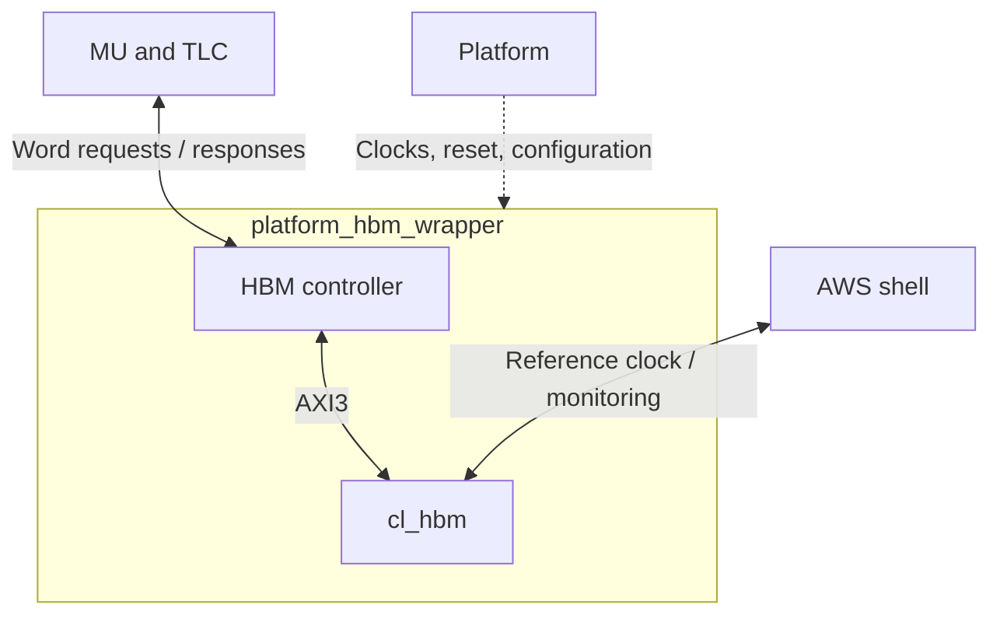

# HBM wrapper specification

`platform_hbm_wrapper` is the F2 HBM subsystem boundary. It accepts
MU and TLC word requests and returns their responses. It contains the
[HBM controller](hbm_controller_spec.md), AWS-configured `cl_hbm`, clock and reset
logic, and shell monitor wiring.

## Boundary and wiring

The controller's AXI ports and the HBM initialization signals stay inside the
wrapper. The external ports are the two client interfaces, source clocks and
reset, client-interface clock and reset outputs, configuration, and shell
monitor connections. The wrapper adds no client queues or response reordering;
the controller owns those behaviors.

This specification defines the F2 platform contract. SoC composition owns the
platform address decoder and connections to MU, TLC, and the AWS shell.

### Parameters

The wrapper exposes and passes through the controller's `NUM_HBM_PORTS`,
`WIDTH_INTERFACE`, and `MAX_READS_IN_FLIGHT` parameters, with the defaults,
constraints, and derived widths in the
[controller parameter table](hbm_controller_spec.md#parameters).

The wrapper connects controller port `n` to native `cl_hbm` port `AXI_nn`, for
zero through `NUM_HBM_PORTS - 1`. The remaining native ports have request-valid,
`RREADY`, and `BREADY` tied low, with unused request payloads tied to zero.
Reducing the port count changes available ingress bandwidth; it does not reduce
the configured HBM capacity. The controller's ingress-selection policy remains
an [open decision](hbm_controller_spec.md#open-decisions).

The IP uses the configuration pinned in
[dependencies.json](../../tb/memory/f2_hbm/dependencies.json): two stacks, 16 GiB,
32 native 256-bit AXI3 ports, 34-bit byte addresses, six-bit IDs, and global
addressing. The wrapper uses AXI3 directly, without a protocol converter.
User parity is disabled; write parity is tied to zero and read parity is unused.
`USER_MON_APB_EN` is enabled for both stacks.

Use AWS's
[`cl_mem_hbm_wrapper`](https://github.com/aws/aws-fpga/blob/c34f88e97eaf8a9b6ea7a3516ab65ee64690ab82/hdk/cl/examples/cl_mem_perf/design/cl_mem_hbm_wrapper.sv)
as the reference for native IP and monitor connections.

### MU and TLC

The wrapper exposes the `mu_*` and `tlc_*` ports listed in the
[client port table](hbm_controller_spec.md#client-ports), with the
same names, widths, directions, and reset values. It connects each port to the
corresponding controller port. The
[controller specification](hbm_controller_spec.md) defines the client protocol,
request handling, ordering, errors, and backpressure.

Both clients use `o_clk_450m` and `o_rst_450m_n` for these interfaces. If the rest
of a client uses another clock, its integration supplies a clock-domain bridge.
The wrapper contains no asynchronous MU/TLC bridge. Clients reset their interface
tracking with the controller, following its
[reset contract](hbm_controller_spec.md#errors-and-reset).

### Platform clocks, reset, and configuration

Directions are relative to `platform_hbm_wrapper`.

| Port | Direction | Width | Behavior |
| --- | --- | --- | --- |
| `i_clk_250m` | Input | 1 | Source for AXI clock generation and configuration logic. |
| `i_rst_250m_n` | Input | 1 | Platform active-low reset, synchronized to `i_clk_250m`. |
| `i_clk_hbm_ref` | Input | 1 | Shell 100 MHz reference; drives both HBM reference inputs and APB clocks. |
| `o_clk_450m` | Output | 1 | Generated AXI clock for native HBM ports, controller, and client interfaces. |
| `o_rst_450m_n` | Output | 1 | Active-low run reset for the controller and client interfaces; held low throughout initialization. |
| `hbm_stat_bus` | Slave interface | `cfg_bus_t` | Local reset/status access in the 250 MHz domain. |
| `o_cl_sh_hbm_stat_int` | Output | 8 | Shell status-interrupt path; tied to zero. Controller fatal status is read through configuration. |

The 100 MHz clock and its functional reset remain internal. Readiness is
available through configuration status; it is not a separate external port.

The configuration interface uses the default widths of AWS
[`cfg_bus_t`](https://github.com/aws/aws-fpga/blob/c34f88e97eaf8a9b6ea7a3516ab65ee64690ab82/hdk/common/lib/interfaces.sv).

| Member | Direction | Width | Behavior |
| --- | --- | --- | --- |
| `addr` | Input | 32 | Local byte address from the platform decoder. |
| `wdata` | Input | 32 | Register write data. |
| `wr` | Input | 1 | Write request; mutually exclusive with `rd`. |
| `rd` | Input | 1 | Read request; mutually exclusive with `wr`. |
| `user` | Input | 3 | Tie to zero. |
| `ack` | Output | 1 | One-cycle acknowledgment for each request. |
| `rdata` | Output | 32 | Read result, valid with acknowledgment. |

The master holds its request, address, and write data until `ack`, then drives
`wr` and `rd` low for at least one cycle before another request. The wrapper
acknowledges a held request once and waits for both request signals to go low
before accepting another. Configuration remains operational during software
HBM reset; platform reset clears its request state and drives `ack` low.

### Shell HBM monitor ports

Both configured stacks require monitor connections to the shell. In the table,
`s` is replaced by `0` or `1` in each wrapper, shell, and IP port name.
Directions are relative to `platform_hbm_wrapper`.

| Wrapper port | Direction | Width | Connection and behavior |
| --- | --- | --- | --- |
| `i_hbm_apb_preset_n_s` | Input | 1 | Shell `hbm_apb_preset_n_s`, connected directly to `cl_hbm.MON_APB_s_PRESET_N`. |
| `o_hbm_apb_paddr_s` | Output | 22 | `cl_hbm.APB_s_PADDR_MON` to shell `hbm_apb_paddr_s`. |
| `o_hbm_apb_pprot_s` | Output | 3 | Tie to zero for shell `hbm_apb_pprot_s`. |
| `o_hbm_apb_psel_s` | Output | 1 | `cl_hbm.APB_s_PSEL_MON` to shell `hbm_apb_psel_s`. |
| `o_hbm_apb_penable_s` | Output | 1 | `cl_hbm.APB_s_PENABLE_MON` to shell `hbm_apb_penable_s`. |
| `o_hbm_apb_pwrite_s` | Output | 1 | `cl_hbm.APB_s_PWRITE_MON` to shell `hbm_apb_pwrite_s`. |
| `o_hbm_apb_pwdata_s` | Output | 32 | `cl_hbm.APB_s_PWDATA_MON` to shell `hbm_apb_pwdata_s`. |
| `o_hbm_apb_pstrb_s` | Output | 4 | Tie high for shell `hbm_apb_pstrb_s`; monitor writes use full words. |
| `o_hbm_apb_pready_s` | Output | 1 | `cl_hbm.APB_s_PREADY_MON` to shell `hbm_apb_pready_s`. |
| `o_hbm_apb_prdata_s` | Output | 32 | `cl_hbm.APB_s_PRDATA_MON` to shell `hbm_apb_prdata_s`. |
| `o_hbm_apb_pslverr_s` | Output | 1 | `cl_hbm.APB_s_PSLVERR_MON` to shell `hbm_apb_pslverr_s`. |

Monitor signals use the shell's 100 MHz reference domain. The monitor reset inputs
must reach the IP directly, without synchronization or register slices. Other
monitor signals can use APB register slices for timing closure as permitted by the
[AWS shell interface specification](https://github.com/aws/aws-fpga/blob/c34f88e97eaf8a9b6ea7a3516ab65ee64690ab82/hdk/docs/AWS_Shell_Interface_Specification.md#hbm-monitor-interface).
A shell monitor violation blocks the affected stack until the AFI is reloaded;
the software HBM reset does not recover that condition.

The functional APB configuration inputs on `cl_hbm` are held inactive, as in the
AWS reference. `hbm_stat_bus` accesses the wrapper's local reset/status register;
it does not provide direct access to HBM APB registers. The status-interrupt
output does not replace either stack's monitor connections.

## Clocks, startup, and reset

### Clock and reset ownership

The wrapper generates 450 MHz from `i_clk_250m` and distributes it to every
native AXI port and the controller. `i_clk_hbm_ref` supplies both stacks' 100 MHz
reference and APB clocks. These source clocks must remain available throughout
initialization and normal operation.

There are three functional resets: native AXI reset at 450 MHz, native APB reset
at 100 MHz, and controller/client run reset at 450 MHz. The wrapper generates
all three. Each reset asserts without requiring its destination clock and
releases synchronously to that clock. Run reset is distinct from native IP
reset: HBM must leave reset to initialize while the controller stays in reset.

Platform reset or software reset starts a new reset epoch. The wrapper resets
HBM and the controller/client interfaces, clears startup tracking and its
readiness synchronizers, and holds reset long enough to meet the native IP's
reset requirements. A short software reset request must not bypass this
sequence. The CSR access logic remains outside the software-reset domain.

### Startup sequence

1. Hold native and run resets asserted while platform or software reset is
   active. Keep the controller's request-valid, response-ready, and client
   request-ready outputs low.
2. After reset release and clock validity, release native APB and AXI resets
   synchronously in their respective domains. AXI reset release requires the
   AXI clock generator to be locked. Keep run reset asserted.
3. Synchronize each stack's `apb_complete` into the 250 MHz control domain.
   Accept only initialization status from the current reset epoch. Do not
   condition native reset release on `apb_complete`.
4. When both stacks have initialized and clocks remain valid, transfer the run
   permission safely into 450 MHz and release `o_rst_450m_n` synchronously.
   The controller then accepts client requests as its resources permit.

The wrapper passes AXI ready signals directly between HBM and the controller.
Run reset blocks startup traffic; masking ready alone would let the two ends
disagree about accepted transfers.

Loss of AXI clock lock or initialized status after startup asserts run reset
and starts a coordinated functional restart. The wrapper reinitializes HBM
before releasing the controller again, following the controller's
[reset contract](hbm_controller_spec.md#errors-and-reset). A shell monitor reset
holds run reset asserted and blocks functional restart until the AFI is reloaded.
Software reset cannot override that block.

### Software reset and fatal faults

After clients [quiesce traffic](hbm_controller_spec.md#errors-and-reset),
software writes one followed by zero to the reset bit and waits for initialization
and run status. The controller's reset contract also defines cancellation for
forced resets.

A controller protocol fault asserts its internal sticky `fatal_error_o`.
The wrapper synchronizes this level into the configuration domain and reports
it until functional reset. It does not automatically restart on a controller
fault; software polls fatal status and requests a coordinated reset. Ordinary
HBM transaction errors return through the client response channels and do not
trigger subsystem reset.

## Control and status

The platform decoder supplies the register base address. The wrapper decodes
local address bits `[7:0]`; higher bits alias the same local registers.

| Offset | Bits | Access | Meaning |
| --- | --- | --- | --- |
| `0x00` | `0` | R/W | Software HBM reset request; reset value zero. One holds functional reset; zero permits startup. |
| `0x00` | `1` | R/O | Stack 0 initialized, synchronized to 250 MHz and cleared during functional reset. |
| `0x00` | `2` | R/O | Stack 1 initialized, synchronized to 250 MHz and cleared during functional reset. |
| `0x00` | `3` | R/O | AXI clock generator locked, synchronized to 250 MHz. |
| `0x00` | `31:4` | R/O | Zero. |
| `0x04` | `0` | R/O | Controller fatal fault, synchronized to 250 MHz; cleared by functional reset. |
| `0x04` | `1` | R/O | Run reset released, synchronized to 250 MHz. This does not guarantee queue capacity or absence of a fatal fault. |
| `0x04` | `31:2` | R/O | Zero. |

Writes affect only bit zero at offset `0x00`. Writes to other addresses are
acknowledged without effect. Unmapped reads return `32'hdead_dead`.
The reset/status layout at `0x00` follows AWS's
[common HBM wrapper](https://github.com/aws/aws-fpga/blob/c34f88e97eaf8a9b6ea7a3516ab65ee64690ab82/hdk/common/lib/hbm_wrapper.sv);
`0x04` is the project wrapper's controller-status extension.

Software polls `0x00[3:1]` for `3'b111`, then `0x04[1]` for one before submitting
work. During operation it polls `0x04[0]` to detect a required reset. The
status-interrupt output carries no fatal notification.

## Verification requirements

Wrapper verification must instantiate the wrapper and exercise its boundaries:

- Delay each stack's initialization independently, including a stack that never
  completes. Check that native resets release while run reset stays asserted,
  and that no client or AXI request is accepted before both stacks initialize.
- Exercise platform reset, short software-reset requests, reset with outstanding
  work, and restart with stale initialization samples. Check cancellation,
  synchronized run-reset release, and absence of responses from prior epochs.
  Include stalled address/data channels, partial writes, buffered responses,
  and independently phased 100, 250, and 450 MHz clocks.
- Check lock loss with a stopped 450 MHz clock, initialization loss, and
  controller fatal status. Confirm that run reset asserts without an AXI clock
  edge, fatal status is readable while traffic is halted, and software reset
  restores the startup sequence.
- Check configuration acknowledgment, held requests, reset/status values,
  unmapped reads, and access during software reset.
- Check native port mapping and unused-port tie-offs for one, a partial set,
  and all 32 ingress ports. Exercise client read/write traffic and backpressure
  through the wrapper at each supported client data width.
- Check both monitor paths and direct monitor-reset wiring against the pinned
  IP and shell ports. Confirm that a monitor reset cannot cause automatic
  resumption of traffic without AFI reload.

The [existing F2 HBM test](../../tb/memory/f2_hbm/README.md) instantiates `cl_hbm`
directly. Its results do not validate this wrapper's startup, clock/reset,
configuration, or monitor wiring. Simulation, CDC/reset analysis, and an F2
implementation build are separate evidence for those properties.
