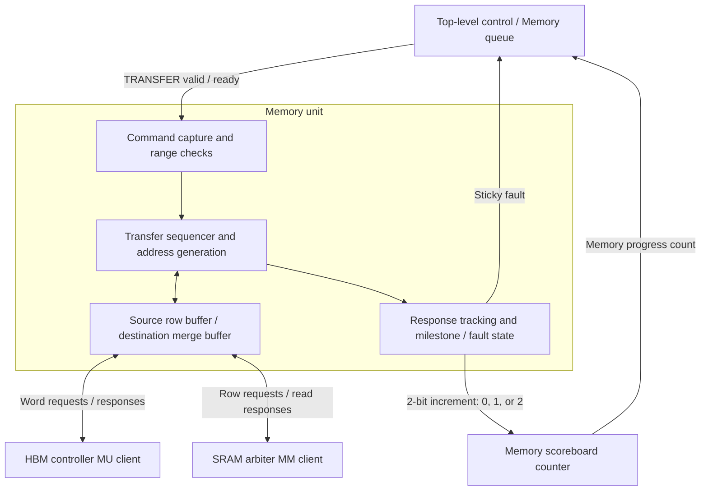

# Memory Unit Spec

## 1. Summary

The memory unit (MU) executes `TRANSFER` commands between HBM and logical SRAM.
It copies contiguous raw bytes, generates addresses, converts HBM words to SRAM
rows, and tracks responses and the two Memory queue milestones. It sends a 2-bit
increment to the external scoreboard, which is a progress counter read by top-level control (TLC).

The pinned [command format](https://github.com/SiliconBadgers/rtl/blob/182e7f8365ae1a2936242e59436f89bb31eed6b0/docs/command-format.md)
defines command fields and milestone meanings. The MU uses the
[HBM client protocol](hbm_controller_spec.md#client-protocol) and the SRAM
interface defined in section 5.3.

## 2. Block diagram

The transfer sequencer advances source and destination addresses and tracks the
remaining byte count. It issues reads, assembles destination data in the buffers,
and issues writes. Response tracking determines when those accesses complete and
when each milestone becomes eligible.

## 3. Parameters

| Parameter | Default | Valid range | Description |
| --- | --- | --- | --- |
| `HbmAddressWidth` | 34 for F2 | Must match platform | Command HBM byte-address width. |
| `SramAddressWidth` | 32 | Must match SRAM interface | Command logical SRAM byte-address width. |
| `TransferLengthWidth` | To be selected | Positive integer | Independent transfer byte-count width. |
| `CounterWidth` | To be selected | At least 2 | External scoreboard counter width, shared with TLC. |
| `WIDTH_INTERFACE` | 512 | Powers of two, 256–1024 | HBM client data width in bits. |
| `SRAM_ROW_BYTES` | 512 | Fixed by SRAM interface | Bytes in one physical SRAM row. |
| `SRAM_CAPACITY_BYTES` | 8 MiB | Fixed by SRAM interface | Accessible logical SRAM capacity. |
| `HBM_WORD_BYTES` | 64 | Derived: `WIDTH_INTERFACE / 8` | Bytes per HBM client request. |
| `HBM_WORD_ADDR_WIDTH` | 28 | Derived: `HbmAddressWidth - $clog2(HBM_WORD_BYTES)` | HBM client word-address width. |
| `HBM_WORDS_PER_ROW` | 8 | Derived: `SRAM_ROW_BYTES / HBM_WORD_BYTES` | HBM words per aligned SRAM row. |

The MU supports one active command, at most one outstanding HBM request across
reads and writes, and at most one outstanding SRAM request. Provide a source row
buffer and a destination merge buffer, each at least 512 bytes for this geometry.

## 4. Clocks and resets

`clk_i` clocks all MU interfaces. For a direct F2 connection it is the wrapper's
450 MHz client clock, and `rst_ni` follows its active-low client run reset.
Reset asserts asynchronously and releases synchronously to `clk_i`.
Integration must bridge any SRAM or TLC interface in a different domain.

Reset clears active-command state, response tracking, milestone state, and fault
status, and drives the scoreboard increment output to zero. The external
scoreboard counter resets to zero at the same boundary.
Request-valid, HBM response-ready, and command-ready outputs are low during
reset. SRAM contents persist across MU reset. Coordinate reset with TLC, the
SRAM response pipeline, and HBM client tracking to discard canceled responses
before accepting new work.

## 5. Ports

### 5.1 Control and status

| Port | Direction | Width | Reset value | Description |
| --- | --- | --- | --- | --- |
| `clk_i` | Input | 1 | — | Interface clock. |
| `rst_ni` | Input | 1 | — | Active-low coordinated reset. |
| `cmd_valid_i` | Input | 1 | — | Eligible `TRANSFER` payload is valid. |
| `cmd_ready_o` | Output | 1 | 0 | MU can capture a command. |
| `cmd_direction_i` | Input | 1 | — | HBM-to-SRAM load or SRAM-to-HBM store. |
| `cmd_hbm_address_i` | Input | `HbmAddressWidth` | — | First HBM byte. |
| `cmd_sram_address_i` | Input | `SramAddressWidth` | — | First logical SRAM byte. |
| `cmd_length_bytes_i` | Input | `TransferLengthWidth` | — | Number of contiguous bytes copied. |
| `scoreboard_increment_o` | Output | 2 | `2'b00` | Number of newly published milestones this cycle: zero, one, or two. |
| `busy_o` | Output | 1 | 0 | Accepted command remains active, including fault drain. |
| `fault_o` | Output | 1 | 0 | Sticky validation, transaction, or protocol fault; cleared by reset. |

The MU accepts a decoded `TRANSFER` payload after its queue dependencies are
satisfied. Each value on `scoreboard_increment_o` advances the external counter
by that many milestones on the rising clock edge. An increment of two publishes
both ordered milestones together.

| `scoreboard_increment_o` | Meaning |
| --- | --- |
| `2'b00` | No new milestone. |
| `2'b01` | One new milestone. |
| `2'b10` | Two ordered milestones become eligible together. |
| `2'b11` | Reserved encoding. |

The increment output is sampled every cycle. Publish each milestone exactly
once, then drive zero until another milestone becomes eligible.

### 5.2 HBM client

The HBM interface connects to the controller's `mu_*` ports:

| MU port group | Direction | Payload | Behavior |
| --- | --- | --- | --- |
| `mu_wvalid_o`, `mu_waddr_o`, `mu_wdata_o` | Output | Word address and `WIDTH_INTERFACE` data bits | One full-word write. |
| `mu_wready_i` | Input | 1 bit | Write request acceptance. |
| `mu_bvalid_i`, `mu_berror_i` | Input | Completion and error | Write response. |
| `mu_bready_o` | Output | 1 bit | MU can accept write response. |
| `mu_arvalid_o`, `mu_araddr_o` | Output | Word address | One full-word read. |
| `mu_arready_i` | Input | 1 bit | Read request acceptance. |
| `mu_rvalid_i`, `mu_rdata_i`, `mu_rerror_i` | Input | `WIDTH_INTERFACE` data bits and error | Read response. |
| `mu_rready_o` | Output | 1 bit | MU can accept read response. |

Word addresses have `HBM_WORD_ADDR_WIDTH` bits. Request-valid and response-ready
outputs reset to zero; request payloads reset to zero. Request and response
handshakes obey the [controller client protocol](hbm_controller_spec.md#client-protocol).

### 5.3 SRAM client and fixed completion timing

The MU uses row request and read-data ports with fixed one-cycle completion.

| MU port | Direction | Width | Reset value | Description |
| --- | --- | --- | --- | --- |
| `mm_req_valid_o` | Output | 1 | 0 | Row request is valid. |
| `mm_req_ready_i` | Input | 1 | — | Arbiter accepts the row request. |
| `mm_req_is_write_o` | Output | 1 | 0 | One for write, zero for read. |
| `mm_req_addr_o` | Output | 32 | 0 | Logical byte address, aligned to 512 bytes. |
| `mm_req_wdata_o` | Output | 4096 | 0 | Full row; byte `i` occupies bits `[8*i +: 8]`. |
| `mm_rsp_rdata_i` | Input | 4096 | — | Read row, sampled one cycle after an accepted read. |

A request is accepted on rising edge `n` when `mm_req_valid_o` and
`mm_req_ready_i` are both high. It completes on rising edge `n + 1`:

- For a read, `mm_rsp_rdata_i` is valid for capture on edge `n + 1`.
- For a write, the row is committed and visible to subsequent reads on edge
  `n + 1`.

Arbitration may delay acceptance, but cannot delay an accepted operation's
completion. The MU delays its acceptance indication and operation type by one
cycle to capture read data or retire a write. Reset clears the delayed acceptance indication and cancels the
pending operation's retirement.

## 6. Functional description

### 6.1 Programming model and validation

The MU accepts a command while idle and fault-free, retains its fields through
execution, and accepts the next command after full completion.

For each byte offset `i` in `[0, length_bytes)`, a load copies
`HBM[hbm_address + i]` to `SRAM[sram_address + i]`; a store reverses the source
and destination.

Reject zero-length transfers. Validate both end-exclusive address sums using
widened arithmetic before issuing memory requests. Reject
wraparound, inaccessible HBM ranges, and SRAM addresses outside the configured
capacity. The aligned words or rows accessed for partial transfers must also
fall in accessible ordinary memory.

### 6.2 Address generation, width conversion, and partial writes

Both command addresses are byte addresses. An HBM request at aligned byte address
`a` uses word address `a / HBM_WORD_BYTES`. SRAM requests use byte addresses
rounded down to `SRAM_ROW_BYTES`. Walk both byte ranges in increasing order;
their alignment offsets can differ.

Split work at source and destination boundaries, track the bytes consumed, and
place only the selected bytes in the corresponding destination positions.
At default widths, an aligned 512-byte load needs eight HBM reads and one SRAM
write. An aligned 512-byte store needs one SRAM read and eight HBM writes.

Use read-modify-write for each partially covered destination row or HBM word:

1. Read the complete destination row or word into the merge buffer.
2. Replace only bytes inside the command's destination range with source bytes.
3. Write the complete merged row or word and wait for its completion.

Full destination rows or words bypass the preservation read. A failed preservation
read faults the transfer before writing that granule. Count only source SRAM
reads toward the store's source-read milestone. Keep source and merge storage
separate while assembling a destination granule; retain its merged data until
write completion.
Source storage can be reused once its selected bytes have been staged safely
in destination storage or written successfully.

Software reserves every physical destination row or HBM word touched by a
read-modify-write for the whole operation, including bytes outside the requested
range. Keep source bytes stable until the MU has captured them. Release each
buffer only after its dependent accesses finish.

### 6.3 Loads: HBM to SRAM

Read the HBM words covering the source interval, check each response, and assemble
the destination SRAM row. Preserve untouched SRAM bytes for partial rows as
specified above. Submit the full row to the arbiter, retain tracking until its
one-cycle write completion, then advance to the next row.

The first milestone becomes eligible after all requested bytes in the first
physical destination SRAM row have committed. For transfers shorter than a row,
wait until every transferred byte has committed, including a second row if the
range crosses a boundary. Full completion requires all requested destination
rows to have committed and no requests to remain outstanding.

### 6.4 Stores: SRAM to HBM

Reserve the source row buffer, request an aligned SRAM row, and capture its
read data exactly one cycle after acceptance. Serialize the selected source bytes
into HBM words, preserving untouched destination bytes for partial words. A
destination word can contain bytes from two source rows. Stage the first row's
remaining bytes in the merge buffer before replacing the source buffer with the next row.
Track the pending write separately from source-buffer ownership.

The first milestone becomes eligible when the requested portion of the first
physical source SRAM row has been captured. For a transfer shorter than a row
that spans a row boundary, wait until the entire transferred SRAM portion has
been captured. Full completion requires every HBM write response to have been
accepted successfully, including the final partial word.

### 6.5 Milestones and streaming consumption

For zero-based command ordinal `j`, publish the first milestone as `2*j + 1`
and full completion as `2*j + 2`, modulo `2^CounterWidth`. The MU tracks which
milestones have been published and outputs one for a newly eligible milestone,
or two when both become eligible together. The external scoreboard stores the
wrapping count, initially zero. Publish milestones from successful SRAM source
reads or committed destination writes, according to the transfer direction.

For any transfer shorter than 512 bytes, the first milestone waits for the
entire transferred SRAM portion to be written for a load or read for a store,
including both rows if it crosses a boundary. The milestone covers the
transferred bytes; source-buffer reuse waits for all dependent reads to finish.

Early load consumption requires a row-aligned destination, a non-transposed
consumer, and a non-revocable writer/reader schedule that keeps every read behind
its committed write. All other consumers wait for full transfer completion.

Milestone targets follow the command format's
[queue progress and dependency rules](https://github.com/SiliconBadgers/rtl/blob/182e7f8365ae1a2936242e59436f89bb31eed6b0/docs/command-format.md#queue-progress-and-dependencies).

### 6.6 Buffering and backpressure

Reserve space before every request and finish its response before issuing
another request on that endpoint. Retain captured SRAM data throughout HBM
backpressure.

### 6.7 Errors, stops, and restarts

Validation failures set sticky `fault_o` without memory traffic or milestones.
An HBM transaction error or MU protocol fault sets `fault_o`, blocks new commands,
and stops selecting new work. Already asserted request-valid and payloads remain
stable until accepted or reset. Drain accepted requests when responses remain
available, retaining their tracking and capturing any pending SRAM read on its
scheduled return edge. Clear `busy_o` after this drain; retain `fault_o` until
coordinated reset.

A first milestone published before a later failure remains published. Withhold
full completion and retain `fault_o` so control can stop dependent work and
recover. A fault that prevents outstanding responses from arriving requires
coordinated reset.

A failed or canceled transfer can leave its destination partially updated.
Restore affected data before reuse. Reset cancels accepted work, clears MU
milestone tracking, and resets the external scoreboard counter to zero. Reset or
rebuild dependent queues and wait targets at the same boundary. For an orderly
stop, finish the active transfer before resetting the MU.

### 6.8 Timing

| Operation | Conditions | Latency | Request count |
| --- | --- | --- | --- |
| SRAM row read or write | Request accepted on edge `n` | Exactly 1 cycle; capture read data or commit write on edge `n + 1` | 1 SRAM request. |
| Aligned 512-byte load | Default 512-bit HBM words | Variable; includes HBM responses and SRAM write commitment | 8 HBM reads, 1 SRAM write. |
| Aligned 512-byte store | Default 512-bit HBM words | Variable; includes SRAM read and all HBM write responses | 1 SRAM read, 8 HBM writes. |
| Partial destination granule | Successful preservation read | Adds a read before that destination write | One extra read per partial destination row or word. |
| First milestone to full completion | Remaining data or writes outstanding | Variable; may be zero cycles | Depends on remaining transfer. |

### 6.9 Load, compute, and store example

With default geometry, load 1024 bytes from HBM byte address `0x1000` into SRAM
byte address `0x2000`. The MU reads HBM word addresses `0x40` through `0x4f` and
commits SRAM rows at `0x2000` and `0x2200`. The MU outputs an increment of one
after each row commits, advancing the external scoreboard counter first to one
and then to two. In this example, compute waits for target two before reading
the input.

Compute writes a 512-byte result at SRAM address `0x4000`. Software makes the
following store wait on that engine's output-visible milestone. The MU then
reads the result row and writes eight HBM words beginning at byte address
`0x8000` (word address `0x200`). As the second Memory command, its source-read
milestone is three and successful final write completion is four. Software waits
for the appropriate source-release or full-completion dependency before reusing
buffers or consuming the HBM result.

## 7. Requirements

| ID | Requirement |
| --- | --- |
| MU-R1 | Copy exactly the requested bytes in both directions and preserve all other destination bytes, including partial words and rows. |
| MU-R2 | Validate addresses and length before issuing memory requests; preserve the requested byte range. |
| MU-R3 | Retain requests through stalls and reserve capacity for every accepted response. |
| MU-R4 | Publish exactly two ordered milestones for each successful command through the 2-bit scoreboard increment output, using committed SRAM writes and completed HBM writes as visibility points. |
| MU-R5 | Capture SRAM reads and commit SRAM writes exactly one cycle after acceptance, using delayed request state. |
| MU-R6 | Halt successful retirement on errors and coordinate cancellation and counter reset across clients. |

Verification must check byte-exact results and unchanged surrounding bytes for
both directions, differing source/destination offsets, short transfers crossing
rows, and lengths around HBM-word and SRAM-row boundaries. Include a store longer
than 512 bytes with SRAM offset zero and HBM offset one, so a destination word
must combine two source rows. Exercise each supported HBM width, independent
endpoint stalls before request acceptance, fixed one-cycle SRAM read/write completion, external counter wrap, and simultaneous
milestones. Check that stalled requests do not trigger completion, that read data
is captured on the scheduled edge, and that reset cancels pending retirement.
Check increment values zero, one, and two, reject the reserved encoding, and
confirm that idle cycles and faults do not repeat previously published increments.
Check invalid ranges, zero length, preservation-read failures, HBM errors,
unexpected responses, and reset during stalled or outstanding work.

## 8. Corner cases

| Condition | Behavior | Reference |
| --- | --- | --- |
| Source and destination offsets differ | Repack selected bytes across word/row boundaries without changing byte order. | Section 6.2 |
| Short or partial-row transfer | Preserve other bytes; first milestone covers all transferred SRAM bytes for a short command. | Sections 6.2 and 6.5 |
| HBM stalls after SRAM read | Retain source row and stop issuing requests that need unavailable storage. | Section 6.6 |
| SRAM write accepted on edge `n` | Commit on edge `n + 1`; withhold the corresponding load milestone until then. | Section 5.3 |
| Error after first milestone | Keep published progress, withhold success completion, and assert fault. | Section 6.7 |
| Counter target wraps to zero | Zero disables the wait; software uses another valid dependency. | Section 6.5 |
