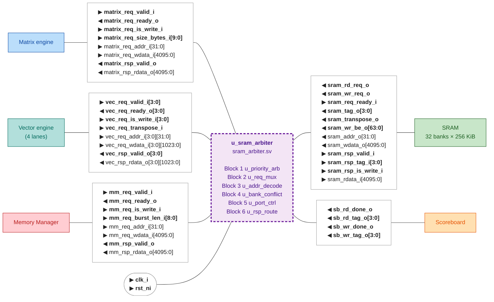
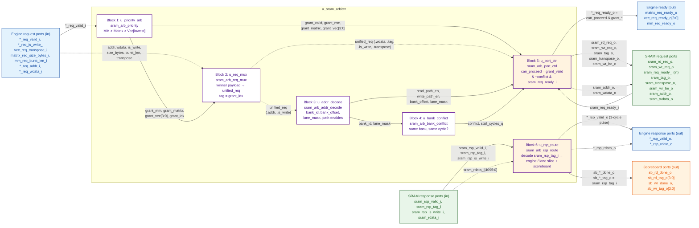
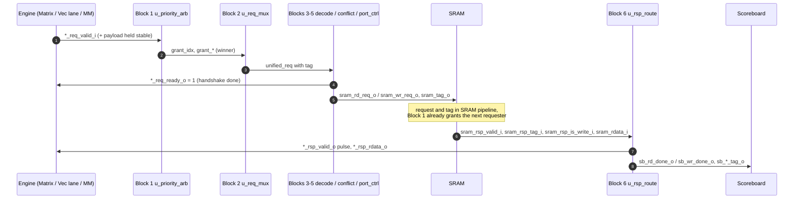

# sram_arbiter I/O Scheme

`sram_arbiter` shares the 8 MiB on-chip SRAM (32 banks × 256 KiB) between the Matrix engine, the
four Vector lanes and the Memory Manager. It arbitrates requests, tags them, sends them to the
SRAM, routes tagged responses back, and reports completions to the scoreboard.

In section 2, solid arrows are control signals (valid, ready, strobes, selects, tags) and dotted
arrows are data and address payloads.

## 1. Top-level ports

Each interface box lists the ports between `sram_arbiter` and one neighbour. `▶` marks an input
to `sram_arbiter` and `◀` an output from it. Control signals are in bold; data and address
payloads are plain.



## 2. Internal blocks



Orange blocks (5 and 6) changed in the simplified design with no RAW/WAR checker.
`unified_req` is a packed struct of type `mem_req_t` from `sram_arbiter_pkg`.

## 3. Package and port list

Suggested package and structs:

```systemverilog
package sram_arbiter_pkg;

  localparam int unsigned NUM_LANES       = 4;
  localparam int unsigned ADDR_WIDTH      = 32;
  localparam int unsigned DATA_WIDTH      = 4096;  // 512 B SRAM row
  localparam int unsigned LANE_DATA_WIDTH = 1024;  // 128 B per Vector lane
  localparam int unsigned TAG_WIDTH       = 4;
  localparam int unsigned SIZE_WIDTH      = 10;
  localparam int unsigned BURST_LEN_WIDTH = 9;
  localparam int unsigned WR_BE_WIDTH     = 64;    // width under review

  // Interface-visible encoding, so values are explicit.
  typedef enum logic [TAG_WIDTH-1:0] {
    TagMm     = 4'd0,
    TagMatrix = 4'd1,
    TagVec0   = 4'd2,
    TagVec1   = 4'd3,
    TagVec2   = 4'd4,
    TagVec3   = 4'd5
  } req_tag_e;

  typedef struct packed {
    logic [ADDR_WIDTH-1:0] addr;
    logic [DATA_WIDTH-1:0] wdata;
    logic                  is_write;
    logic [SIZE_WIDTH-1:0] size_bytes;
    logic                  transpose;
    req_tag_e              tag;
  } mem_req_t;

endpackage
```

Ports:

```systemverilog
module sram_arbiter
  import sram_arbiter_pkg::*;
(
  input  logic                                      clk_i,
  input  logic                                      rst_ni,

  // Matrix engine
  input  logic                                      matrix_req_valid_i,
  output logic                                      matrix_req_ready_o,
  input  logic                                      matrix_req_is_write_i,
  input  logic [SIZE_WIDTH-1:0]                     matrix_req_size_bytes_i,
  input  logic [ADDR_WIDTH-1:0]                     matrix_req_addr_i,
  input  logic [DATA_WIDTH-1:0]                     matrix_req_wdata_i,
  output logic                                      matrix_rsp_valid_o,
  output logic [DATA_WIDTH-1:0]                     matrix_rsp_rdata_o,

  // Vector engine, one channel per lane
  input  logic [NUM_LANES-1:0]                      vec_req_valid_i,
  output logic [NUM_LANES-1:0]                      vec_req_ready_o,
  input  logic [NUM_LANES-1:0]                      vec_req_is_write_i,
  input  logic                                      vec_req_transpose_i,
  input  logic [NUM_LANES-1:0][ADDR_WIDTH-1:0]      vec_req_addr_i,
  input  logic [NUM_LANES-1:0][LANE_DATA_WIDTH-1:0] vec_req_wdata_i,
  output logic [NUM_LANES-1:0]                      vec_rsp_valid_o,
  output logic [NUM_LANES-1:0][LANE_DATA_WIDTH-1:0] vec_rsp_rdata_o,

  // Memory Manager
  input  logic                                      mm_req_valid_i,
  output logic                                      mm_req_ready_o,
  input  logic                                      mm_req_is_write_i,
  input  logic [BURST_LEN_WIDTH-1:0]                mm_req_burst_len_i,
  input  logic [ADDR_WIDTH-1:0]                     mm_req_addr_i,
  input  logic [DATA_WIDTH-1:0]                     mm_req_wdata_i,
  output logic                                      mm_rsp_valid_o,
  output logic [DATA_WIDTH-1:0]                     mm_rsp_rdata_o,

  // SRAM request
  output logic                                      sram_rd_req_o,
  output logic                                      sram_wr_req_o,
  input  logic                                      sram_req_ready_i,
  output logic [ADDR_WIDTH-1:0]                     sram_addr_o,
  output logic [DATA_WIDTH-1:0]                     sram_wdata_o,
  output logic [WR_BE_WIDTH-1:0]                    sram_wr_be_o,
  output req_tag_e                                  sram_tag_o,
  output logic                                      sram_transpose_o,

  // SRAM response
  input  logic                                      sram_rsp_valid_i,
  input  req_tag_e                                  sram_rsp_tag_i,
  input  logic                                      sram_rsp_is_write_i,
  input  logic [DATA_WIDTH-1:0]                     sram_rdata_i,

  // Scoreboard completions
  output logic                                      sb_rd_done_o,
  output req_tag_e                                  sb_rd_tag_o,
  output logic                                      sb_wr_done_o,
  output req_tag_e                                  sb_wr_tag_o
);
```

## 4. Interface contracts

| Item | Contract |
| --- | --- |
| Clock / reset | Single domain `clk_i`. `rst_ni` is asserted asynchronously and must be deasserted synchronously to `clk_i` (upstream reset synchroniser). |
| Request channels | Ready/valid. A transfer happens on the rising `clk_i` edge when `*_req_valid_i` and `*_req_ready_o` are both 1. The engine must hold valid and payload stable while stalled and must not wait for ready before asserting valid. |
| Response channels | `*_rsp_valid_o` is a one-cycle pulse with no backpressure; the engine must capture `*_rsp_rdata_o` in that cycle. |
| Scoreboard channel | `sb_*_done_o` are one-cycle pulses with no backpressure; the scoreboard must accept every cycle. |
| SRAM request | Issued only when `sram_req_ready_i` = 1. Exactly one of `sram_rd_req_o` / `sram_wr_req_o` per accepted request. |
| SRAM response | The SRAM returns `sram_rsp_valid_i` with the same tag for reads and writes, plus `sram_rsp_is_write_i` so completions are labelled correctly. Latency is fixed by the SRAM pipeline. |
| Units | Addresses are byte addresses. `matrix_req_size_bytes_i` is in bytes; `mm_req_burst_len_i` counts 512 B beats. |
| Reset / quiesce | Proposed: on reset all in-flight SRAM responses are discarded and the scoreboard is reset in the same domain. To be confirmed. |

## 5. Request and response steps



### Step 1 - Asking the memory

| Signal | Type | What it does |
| --- | --- | --- |
| `*_req_valid_i` (`vec_req_valid_i[3:0]`: one bit per lane) | control | "I have a request." Must stay high until `*_req_ready_o` = 1. |
| `*_req_is_write_i` | control | Direction: 1 = write, 0 = read. Later selects `sram_wr_req_o` vs `sram_rd_req_o`. |
| `*_req_addr_i[31:0]` | data | Where in SRAM. |
| `*_req_wdata_i` | data | Write data (ignored on reads). |
| `matrix_req_size_bytes_i` / `mm_req_burst_len_i` | control | How much to move. |

### Step 2 - Decide

Block 1 `u_priority_arb`. The `*_req_ready_o` answer is driven by Block 5.

| Signal | Type | What it does |
| --- | --- | --- |
| `grant_idx` (`req_tag_e`) | internal | Encoded winner: 0 = MM, 1 = Matrix, 2–5 = Vec lanes 0–3. |
| `grant_valid` | internal | 1 when any requester is valid (replaces `grant != 0`). |
| `grant_mm`, `grant_matrix`, `grant_vec[3:0]` | internal | Same choice, one-hot. Drives the mux select in Block 2. |
| `*_req_ready_o` | control → engine | 1 = accepted this cycle; 0 = hold your request. Only the winner sees 1. |

### Step 3 - Labeling

Block 2 `u_req_mux`.

| Signal | Type | What it does |
| --- | --- | --- |
| `unified_req` (`.addr`, `.wdata`, `.is_write`, `.size_bytes`, `.transpose`) | internal | The winner's request on one shared path (grant = mux select). |
| `unified_req.tag` (`req_tag_e`) | control (ID) | The coat-check ticket; set from the grant and travels to the SRAM and back. |

### Step 4 - Send

Block 3 `u_addr_decode` → Block 4 `u_bank_conflict` → Block 5 `u_port_ctrl` → SRAM request ports.

| Signal | Block | What it does |
| --- | --- | --- |
| `bank_id`, `bank_offset` | 3 | Which bank and which row. |
| `lane_mask[3:0]` | 3 | Active 128 B slices: `1111` for Matrix/MM, one-hot for a Vector lane. |
| `vec_req_transpose_i` → `sram_transpose_o` | 2 → 5 → SRAM | 1-bit flag: transpose requested. If high, supply row 0 from the first, row 1 from the second, and so on. Carried in `unified_req.transpose`. |
| `read_path_en` / `write_path_en` | 3 | Steers the request to the read or write port. |
| `conflict` | 4 | 1 = two accesses need the same bank this cycle; block this one. |
| `stall_cycles_q` | 4 | How long to hold off after a conflict. |
| `can_proceed` | 5 | The final GO: `grant_valid & ~conflict & sram_req_ready_i`. |
| `sram_rd_req_o` / `sram_wr_req_o` | 5 → SRAM | Strobe to start a read or a write; only one fires, chosen by `is_write`. |
| `sram_addr_o`, `sram_wdata_o` | 5 → SRAM | Address and write data. |
| `sram_wr_be_o[63:0]` | 5 → SRAM | Byte enables: which bytes actually get written (only the lane's slice for a Vector write). |
| `sram_tag_o[3:0]` | 5 → SRAM | The ticket handed to the SRAM. |

### Step 5 - Wait

The SRAM keeps the request and tag in its pipeline for some cycles while Block 1 already grants
the next requester, which is why tags are needed.

### Step 6 - Return

SRAM response ports (in) → Block 6 `u_rsp_route` → engine response ports (out).

| Signal | Type | What it does |
| --- | --- | --- |
| `sram_rsp_valid_i` | control (strobe) | "Response is on the bus this cycle." |
| `sram_rsp_tag_i[3:0]` | control (ID) | The returned ticket; Block 6 uses it as the select for the destination. |
| `sram_rsp_is_write_i` | control | 1 = this response completes a write; 0 = a read. |
| `sram_rdata_i[4095:0]` | data | The 512 B of read data. Width under review. |
| `*_rsp_rdata_o` | data → engine | Data delivered to the engine (for a Vector lane, only its 128 B slice). |
| `*_rsp_valid_o` | control → engine | One-cycle pulse: "capture `*_rsp_rdata_o` now." Only the engine matching the tag gets it. |

### Step 7 - Notify

Block 6 → scoreboard ports (out).

| Signal | Type | What it does |
| --- | --- | --- |
| `sb_rd_done_o` | control (strobe) | Pulse: a read finished. |
| `sb_rd_tag_o[3:0]` | ID | Whose read finished. |
| `sb_wr_done_o` | control (strobe) | Pulse: a write finished. |
| `sb_wr_tag_o[3:0]` | ID | Whose write finished. |

## 6. Control signals grouped by job

| Job | Signals |
| --- | --- |
| Handshake (do we transfer?) | `*_req_valid_i` → `*_req_ready_o`; transfer only when both are 1 |
| Direction | `*_req_is_write_i` → `sram_rd_req_o` / `sram_wr_req_o` |
| Who won | `grant_idx`, `grant_*` (mux select on the way in) |
| Go / stop | `conflict`, `stall_cycles_q`, `sram_req_ready_i`, `can_proceed` |
| Which part of the row | `lane_mask`, `sram_wr_be_o` |
| Transpose | `vec_req_transpose_i` → `unified_req.transpose` → `sram_transpose_o` |
| Whose request is this | `unified_req.tag` → `sram_tag_o` → `sram_rsp_tag_i` → `sb_*_tag_o` |
| Notifying that data is here now | `sram_rsp_valid_i`, `*_rsp_valid_o`, `sb_*_done_o` |
