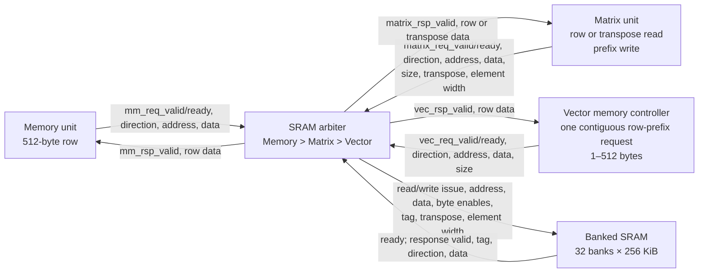
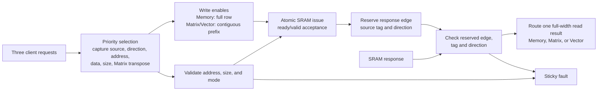

# SRAM arbiter I/O scheme

`sram_arbiter` shares the 8 MiB SRAM between Memory, Matrix, and Vector. Each
client has one request channel. Vector presents one contiguous access, up to a
full 512-byte row, and distributes the returned data to its registers internally.

The [SRAM arbiter specification](sram_arbiter_spec.md) defines address legality,
diagonal banking, transpose layout, completion timing, and faults. The diagrams
below show the proposed request and response path.

## 1. Top-level ports

All client data buses are 4096 bits. Ordinary addresses are 512-byte-aligned
logical byte addresses. A full Vector row takes one request, not four slice
requests. The Vector memory controller splits larger accesses into row requests;
unaligned accesses fault at this interface. Arithmetic lane count and virtual-lane
sequencing do not change the arbiter's channel count.

## 2. Internal blocks

An ordinary request reserves the next cycle's completion edge. A Matrix
transpose read reserves completion two cycles later and blocks new acceptance
in the intervening cycle. The arbiter retains this timing state rather
than a queue of transaction IDs. Tags identify clients; successive requests from
one client reuse its tag and complete in acceptance order.

## 3. Package and port list

The tables below define the proposed shared widths, encodings, and client ports.

| Constant or tag | Value | Meaning |
| --- | --- | --- |
| `ADDR_WIDTH` | 32 | Logical byte-address width. |
| `DATA_WIDTH` | 4096 | Row data width on every client. |
| `SIZE_WIDTH` | 10 | Matrix/Vector byte count, 1–512. |
| `WR_BE_WIDTH` | 512 | One write enable per row byte. |
| `TAG_WIDTH` | 4 | Source-tag width. |
| `TagMm` | 0 | Memory request. |
| `TagMatrix` | 1 | Matrix request. |
| `TagVector` | 2 | Aggregate Vector request. |

For each of `mm`, `matrix`, and `vec`, the following signals are scalar or
single packed buses; there is no Vector channel index.

| Signal | Width | Direction at arbiter | Meaning |
| --- | --- | --- | --- |
| `<client>_req_valid_i` | 1 | Input | Request and payload are valid. |
| `<client>_req_ready_o` | 1 | Output | Request can be accepted on this edge. |
| `<client>_req_is_write_i` | 1 | Input | One for write, zero for read. |
| `<client>_req_addr_i` | 32 | Input | Logical byte address. |
| `<client>_req_wdata_i` | 4096 | Input | Row write data, byte zero in bits `[7:0]`. |
| `<client>_rsp_valid_o` | 1 | Output | Read-result pulse at the reserved completion edge. |
| `<client>_rsp_rdata_o` | 4096 | Output | Entire logical row, or Matrix transpose result. |

Matrix and Vector each supply `*_req_size_bytes_i[9:0]`. For a write, row byte
`j` is enabled exactly when `j < size_bytes`; other bytes retain their contents.
Reads return the whole row. Vector consumes the requested prefix and ignores
returned bytes beyond it. Memory always accesses a whole row and has no size
field.

Only Matrix supplies `matrix_req_transpose_i` and
`matrix_req_element_width_i`. Element-width codes `01`, `10`, and `11` select
8-, 16-, and 32-bit transpose reads; `00` is reserved. Ordinary accesses carry
raw bytes regardless of the stored numerical format.

The SRAM-side ports carry one selected access, its byte enables and source tag,
and the Matrix transpose controls. See the specification's
[SRAM issue](sram_arbiter_spec.md#sram-issue) and
[completion](sram_arbiter_spec.md#completion-and-visibility) tables for their
widths and directions. `fault_o` reports a sticky fault to system fault handling.

## 4. Interface contracts

Requests transfer on a rising `clk_i` edge with valid and ready asserted.
A requester asserts valid independently of ready and holds its payload stable
until acceptance. Arbitration selects Memory, then Matrix, then Vector. At most
one request is accepted per cycle, including when clients address the same row.
The aggregate Vector request already represents all of its requested bytes.

An ordinary read accepted on edge `n` returns data for capture on edge `n + 1`;
an ordinary write commits by that edge. Matrix transpose reads complete on
edge `n + 2`. Read responses have no ready input: the requester reserves buffer
space before issuing and captures every response pulse. Writes do not generate
a client read-result pulse.

All interfaces share `clk_i` and active-low `rst_ni`. Reset asserts
asynchronously and releases synchronously. Coordinate reset across clients,
arbiter, and SRAM to cancel pending work. Committed SRAM bytes remain stored.
Malformed selected requests and unexpected responses latch `fault_o` and stop
new acceptance until reset. The specification defines exact failure precedence.

## 5. Vector access example

To write a 512-byte vector block at logical address `0x2000`, present one request
with `vec_req_is_write_i=1`, `vec_req_size_bytes_i=512`, and all 4096 payload bits.
On acceptance, all 512 SRAM byte enables are asserted. The write commits one
cycle later. A subsequent read of that row returns all 512 bytes in one response.

A write of 97 bytes at the same base enables bytes 0 through 96. Reading the
whole row afterward returns those 97 new bytes followed by the preserved suffix.
The arbiter does not interpret elements, predicates, or virtual lanes.

## 6. Integration and verification

The Vector memory controller owns contiguous request formation, row splitting,
register placement, and space for responses. The arbiter owns shared-port
selection and response routing. Matrix retains the transpose view; Memory and
Vector use ordinary accesses. Queue-level dependencies and milestones remain
with the engine controllers and top-level control.

Verification must cover aggregate Vector reads/writes, partial-write
preservation, contention, stalls, reset, faults, Matrix transpose, and
memory-unit integration.
